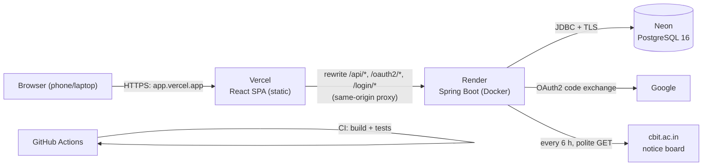
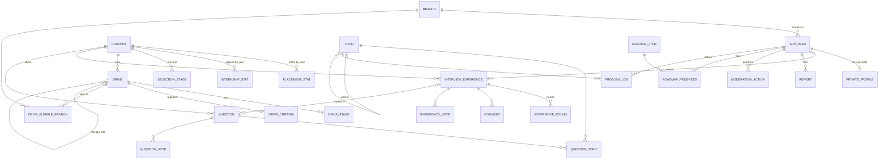

# CampusOA — Build Plan

> CampusOA is an independent student project and is not affiliated with or endorsed by CBIT.

This plan is checkpoint 0. Nothing beyond this file and `.gitignore` exists yet. Once you say **go**, I'll build
milestone by milestone, committing after each one, and stop only at the human checkpoints listed in §8.

---

## 0. Before I start: your machine is missing three tools

I checked what's installed:

| Tool | Status | Needed for | What happens without it |
|---|---|---|---|
| Node 26 / npm 11 | ✅ installed | frontend, report PDF | — |
| git 2.53 | ✅ installed | version control | — |
| Vercel CLI | ✅ installed, logged in | frontend deploy | — |
| **JDK 21** | ❌ missing | compiling and running the backend | I can't build or test the backend locally. CI could still build it, but I'd be coding blind. **Blocker.** |
| **Docker Desktop** | ❌ missing | `docker compose up`, Testcontainers integration tests | Unit tests still run locally, but integration tests only run in GitHub Actions (CI runners ship with Docker). |
| **GitHub CLI (`gh`)** | ❌ missing | `gh repo create … --push`, checking CI | I'd give you the manual steps to create the repo instead. |
| Render CLI | ❌ missing | backend deploy | Fine. I'll give you click-by-click dashboard steps (checkpoint 3). |
| pandoc | ❌ missing | REPORT.pdf | Fine. I'll use `md-to-pdf` + `mermaid-cli` through npm instead. |

Maven itself isn't needed because the repo will ship the Maven Wrapper (`./mvnw`).

**Pick one when you reply:**
- **"go, install them"**: I'll run these winget commands (official packages from Eclipse Adoptium, Docker and GitHub):
  `winget install EclipseAdoptium.Temurin.21.JDK`, `winget install GitHub.cli`, `winget install Docker.DockerDesktop`.
  Docker Desktop needs admin rights, WSL2 and probably a reboot, so you may have to finish that one yourself.
  After `gh` installs, you'll run `gh auth login` yourself, since that's a sign-in.
- **"go, I'll install them"**: you install them and tell me when they're ready.

---

## 1. Features

### MVP (ships and deploys)
| # | Feature | Notes |
|---|---|---|
| F1 | **Google sign-in, domain allow-list, roles** | `ALLOWED_EMAIL_DOMAINS` controls sign-up. `ADMIN_EMAILS` makes the first admins. Roles: STUDENT, MODERATOR, ADMIN. |
| F2 | **Profile** | Name, branch (12 branches), graduation year. CGPA and active backlogs are optional and private (stored in a separate table, never sent to other users). Opt-in to leaderboards. Delete account. |
| F3 | **Drive calendar** | A polite scraper reads the CBIT CDC notice board every 6 h. Admins edit or merge drives and add stages (PPT / OA / GD / Interview). Calendar and list views. Filter by company, branch and stage. |
| F4 | **Company pages** | Roles and CTC by year, internship stipend, selection process, linked drives, experiences, questions, and an admin-editable "how to prepare" section in markdown. Seeded with the public aggregates you gave me, each labelled *"Source: CBIT public placement records (approx.)"* with a link. |
| F5 | **Eligibility checker** | Admins enter each drive's criteria (branches, min CGPA, max backlogs, grad year). Each drive shows the student **Eligible / Not eligible (with reasons) / Criteria unknown**, computed on the server from their private profile. |
| F6 | **Interview experiences + question bank** | Markdown posts with rounds, difficulty and outcome. Questions tagged by topic and difficulty. Anonymous option, upvotes, comments, reports, and full-text search with PostgreSQL `tsvector`. |
| F7 | **Prep tracker** | Roadmap checklist (DSA → OOP → DBMS/SQL → OS → CN → Aptitude → Projects → System design), a DSA problem log, and a dashboard showing streak, topic coverage and problems per week. |
| F8 | **Leaderboards** | Problems solved this week, this month and all time, overall and within your branch and year. Opt-in, off by default. Hand-written SQL with `RANK` / `DENSE_RANK` / `PARTITION BY`. |
| F9 | **Admin panel** | Drives, companies, criteria, moderation queue, users and roles, and scraper run history. |
| F10 | **Static pages** | Posting guidelines, privacy summary, the unofficial-project banner in the footer of every page. |

### Stretch (only after the MVP is live)
S1 email reminders for eligible drives (Resend or Brevo free tier) · S2 timed mock OA · S3 "Batch insights" charts.

---

## 2. Architecture



### The key decision: one origin through Vercel rewrites
The frontend (Vercel) and backend (Render) live on different domains. If the browser called Render directly, the
session cookie would be a **third-party cookie**, which Safari blocks and Chrome is restricting. Most students use
phones, and many use iPhones, so login would break. Instead, `vercel.json` **rewrites** `/api/**`, `/oauth2/**` and
`/login/oauth2/**` to the Render URL. From the browser's point of view, everything comes from one origin, so:
- cookies are first-party, `SameSite=Lax`, `Secure`, `HttpOnly`
- CORS isn't needed for normal traffic. It stays locked to the frontend origin as defence in depth.
- the Google redirect URI is `https://<vercel-domain>/login/oauth2/code/google`

Locally, the Vite dev server proxy does the same job.

### Auth model: server sessions, not JWT
- Spring Security's `oauth2Login()` handles the Google flow. On success, a custom `OAuth2UserService` checks the
  email domain against the allow-list, then creates or updates the user and assigns roles (`ADMIN_EMAILS` → ADMIN).
- **Sessions are stored in Postgres (Spring Session JDBC)**. Render's free tier sleeps and restarts often, so
  in-memory sessions would log everyone out after every cold start.
- **Why not JWT?** For a browser-only app on one origin, a session cookie is simpler and safer. It's `HttpOnly`, so
  XSS can't read it. It can be revoked instantly (ban a user, change a role). There's no refresh-token logic.
  JWT makes sense for mobile apps or many independent services. REPORT.md will explain this trade-off in detail.
- **CSRF**: because we use cookies, CSRF protection is **on**. `CookieCsrfTokenRepository` sets an `XSRF-TOKEN`
  cookie. The SPA reads it and sends it back in an `X-XSRF-TOKEN` header on POST/PUT/PATCH/DELETE.

### Backend layering
`controller` (HTTP, DTOs, validation) → `service` (business rules, transactions, authorisation decisions) →
`repository` (Spring Data JPA for CRUD, `NamedParameterJdbcTemplate` + hand-written SQL for leaderboards, search
and dashboard analytics). Entities never leave the service layer. MapStruct-free hand-written mappers make each
conversion easy to read.

Package layout (feature-first, so each feature is a folder you can study on its own):
```
backend/src/main/java/in/campusoa/
  config/        Security, CORS, rate limiting, OpenAPI, scheduling, properties
  common/        error handling (ApiError, GlobalExceptionHandler), PageResponse, auth helpers
  user/          User, PrivateProfile, Role, Branch, profile endpoints, account deletion
  company/       Company, PlacementStat, InternshipStat, SelectionStage
  drive/         Drive, DriveStage, DriveCriteria, eligibility service
  scraper/       NoticeBoardScraper, RobotsTxtPolicy, ScrapeRun, title parser
  experience/    InterviewExperience, Round, Comment, Vote
  question/      Question, Topic, search
  moderation/    Report, ModerationAction, queue
  prep/          RoadmapItem, RoadmapProgress, ProblemLog, dashboard, leaderboard SQL
  admin/         admin-only controllers (users/roles, drive merge)
```

### Frontend
React 18 + TypeScript + Vite, React Router (data routes), TanStack Query (server state and caching), Tailwind
with a `dark:` class strategy (follows the system setting, with a toggle saved in `localStorage`), and
`react-markdown` + `rehype-sanitize` for safe markdown. It's mobile-first: bottom nav on phones, sidebar on
desktop. A typed API client wraps `fetch`, adds the CSRF header and maps the error JSON.

Pages: Home · Drives (list / calendar) · Drive detail · Companies · Company · Experiences (search) · Experience ·
New experience · Questions · Prep (roadmap / problem log / dashboard) · Leaderboard · Profile & settings ·
Guidelines · Privacy · Admin (drives, companies, criteria, moderation, users, scraper).

---

## 3. Data model (3NF)



| Table | Key columns and constraints |
|---|---|
| `branch` | `code` PK (`CSE`, `CSE_AIML`, `CSE_IOT`, `IT`, `AIDS`, `AIML`, `ECE`, `EEE`, `MECH`, `CIVIL`, `CHEM`, `BIOTECH`), `name`. A lookup table, not an enum, so new branches don't need a code change. |
| `app_user` | `id`, `email` UNIQUE, `google_sub` UNIQUE, `display_name`, `avatar_url`, `role` CHECK in (STUDENT, MODERATOR, ADMIN), `branch_code` FK nullable, `grad_year` CHECK 2020–2040, `leaderboard_opt_in` default **false**, `banned`, timestamps |
| `private_profile` | `user_id` PK/FK ON DELETE CASCADE, `cgpa` NUMERIC(4,2) CHECK 0–10, `active_backlogs` SMALLINT CHECK ≥ 0. **Kept in a separate table** so no general user query can join it by accident. |
| `company` | `id`, `slug` UNIQUE, `name` UNIQUE, `website`, `prep_markdown`, `updated_by` |
| `placement_stat` | `company_id` FK, `academic_year` ('2024-25'), `role_title`, `ctc_min_lpa`, `ctc_max_lpa`, `ctc_is_upto`, `offers`, `source_url`, `source_note`. UNIQUE(company, year, role). |
| `internship_stat` | `company_id`, `academic_year`, `stipend_inr_month`, source fields. UNIQUE(company, year). |
| `selection_stage` | `company_id`, `position`, `stage_type`, `description`. UNIQUE(company, position). |
| `drive` | `id`, `company_id` FK nullable (the parser may fail), `title`, `notice_date`, `pdf_url` UNIQUE (dedupe key for the scraper), `source` (SCRAPED / MANUAL), `raw_title`, `merged_into_id` self-FK, `hidden` |
| `drive_stage` | `drive_id` FK CASCADE, `stage_type` CHECK (PPT, OA, GD, INTERVIEW, OTHER), `starts_at` timestamptz, `mode`, `notes` |
| `drive_criteria` | `drive_id` PK/FK, `min_cgpa`, `max_backlogs`, `grad_year`. *No row means "criteria unknown".* |
| `drive_eligible_branch` | PK(`drive_id`, `branch_code`). A junction table, not a comma-separated column (1NF). |
| `interview_experience` | `author_id` FK ON DELETE SET NULL, `company_id`, `year`, `role_title`, `difficulty` 1–5, `outcome` (SELECTED / REJECTED / WAITING / WITHDREW), `body_md`, `anonymous`, `status` (PUBLISHED / HIDDEN / REMOVED), `search_vector` **generated** tsvector column |
| `experience_round` | `experience_id`, `position`, `name`, `description` |
| `question` | `experience_id` FK nullable, `company_id` FK nullable, `author_id`, `body_md`, `difficulty` (EASY / MEDIUM / HARD), `status`, `search_vector` generated |
| `topic` | `id`, `code` UNIQUE, `name`, `parent_id` self-FK (DSA → arrays, graphs, DP…) |
| `question_topic` | PK(`question_id`, `topic_id`) |
| `experience_vote`, `question_vote` | PK(`user_id`, target_id). The composite PK enforces one vote per user. |
| `comment` | `experience_id`, `author_id` SET NULL, `body`, `status` |
| `report` | `reporter_id`, **`experience_id` / `question_id` / `comment_id` (nullable FKs) + `CHECK (num_nonnulls(...) = 1)`**, `reason`, `status` (OPEN / RESOLVED / DISMISSED), `resolved_by`, `resolved_at`. UNIQUE per reporter and target. |
| `moderation_action` | audit log: `moderator_id`, `action`, target FKs, `note`, `created_at` |
| `roadmap_item` | `section`, `position`, `title`, `description`, `resource_url` |
| `roadmap_progress` | PK(`user_id`, `item_id`), `completed_at` |
| `problem_log` | `user_id` CASCADE, `title`, `url`, `topic_id` FK, `difficulty`, `solved_on` DATE CHECK ≤ today + 1. **UNIQUE(user_id, url)** stops leaderboard padding. |
| `scrape_run` | `started_at`, `finished_at`, `status`, `http_status`, `etag`, `last_modified`, `items_seen`, `items_new`, `error` |
| `SPRING_SESSION*` | created by Spring Session's own schema (in a Flyway migration) |

**Indexes, each tied to a query:**
- `drive(notice_date DESC)`: drive list and calendar month range
- `drive_stage(starts_at)`: "upcoming stages" on the calendar
- `interview_experience(company_id, created_at DESC) WHERE status='PUBLISHED'`: company page feed (partial index)
- GIN on `interview_experience.search_vector` and `question.search_vector`: full-text search
- `problem_log(solved_on, user_id)`: weekly and monthly leaderboard range scans
- `problem_log(user_id, solved_on DESC)`: dashboard, streak and per-week chart
- `report(status, created_at) WHERE status='OPEN'`: moderation queue
- FK columns used in joins (`question_topic(topic_id)`, `comment(experience_id)` …)

**Leaderboard SQL (sketch). REPORT.md explains it line by line.**
```sql
WITH counts AS (
  SELECT u.id, u.display_name, u.branch_code, u.grad_year, COUNT(p.id) AS solved
  FROM app_user u JOIN problem_log p ON p.user_id = u.id
  WHERE u.leaderboard_opt_in AND NOT u.banned
    AND p.solved_on >= :from AND p.solved_on < :to
  GROUP BY u.id)
SELECT *,
  RANK()       OVER (ORDER BY solved DESC)                                  AS overall_rank,
  DENSE_RANK() OVER (PARTITION BY branch_code, grad_year ORDER BY solved DESC) AS cohort_rank
FROM counts ORDER BY overall_rank LIMIT :limit OFFSET :offset;
```

---

## 4. REST API (all under `/api`, JSON, paginated lists: `?page=0&size=20&sort=…`)

Paginated response: `{ "content": [...], "page": 0, "size": 20, "totalElements": 134, "totalPages": 7 }`
Error response (every error): `{ "status": 400, "error": "Bad Request", "code": "VALIDATION_FAILED", "message": "...", "fieldErrors": [{"field":"year","message":"must be ≥ 2015"}], "path": "/api/experiences", "timestamp": "..." }`

| Method | Path | Who | Purpose |
|---|---|---|---|
| GET | `/api/me` | auth | current user, role, profile (own private fields included) |
| PUT | `/api/me/profile` | auth | update branch, year, CGPA, backlogs, opt-in |
| DELETE | `/api/me` | auth | delete account (posts become "deleted user") |
| GET | `/api/branches`, `/api/topics` | public | lookup lists |
| GET | `/api/drives?company=&branch=&stage=&from=&to=` | public* | list and calendar. *Eligibility is added when signed in. |
| GET | `/api/drives/{id}` | public* | detail + stages + criteria + my eligibility |
| GET | `/api/companies?q=` · `/api/companies/{slug}` | public | list · page (stats, stages, drives) |
| GET | `/api/companies/{slug}/experiences` · `/questions` | public | company-linked content |
| GET | `/api/experiences?q=&company=&year=&outcome=` | public | search and list |
| GET | `/api/experiences/{id}` | public | detail (author hidden if anonymous, unless the viewer is MOD+) |
| POST / PUT / DELETE | `/api/experiences[/{id}]` | auth (author) | create / edit / delete own. Rate-limited. |
| POST / DELETE | `/api/experiences/{id}/vote` | auth | upvote / remove. Rate-limited. |
| GET / POST | `/api/experiences/{id}/comments` | public / auth | comments. Rate-limited. |
| GET | `/api/questions?q=&topic=&difficulty=&company=` | public | question bank |
| POST | `/api/questions` · `/api/questions/{id}/vote` | auth | add · vote |
| POST | `/api/reports` | auth | report a post, question or comment. Rate-limited. |
| GET | `/api/prep/roadmap` · PUT `/api/prep/roadmap/{itemId}` | auth | checklist + tick / untick |
| GET / POST / DELETE | `/api/prep/problems[/{id}]` | auth | problem log |
| GET | `/api/prep/dashboard` | auth | streak, coverage, per-week |
| GET | `/api/leaderboard?period=WEEK|MONTH|ALL&scope=OVERALL|COHORT` | auth | ranked list + my rank |
| GET | `/api/mod/reports?status=OPEN` | MOD+ | moderation queue |
| POST | `/api/mod/reports/{id}/resolve` | MOD+ | hide / remove / dismiss, with a note |
| POST / PUT / DELETE | `/api/admin/drives…`, `/api/admin/drives/{id}/merge`, `/criteria`, `/stages` | ADMIN | drive management |
| POST / PUT | `/api/admin/companies…`, `/stats`, `/prep` | ADMIN | company management |
| GET / PUT | `/api/admin/users?q=` · `/api/admin/users/{id}/role` · `/ban` | ADMIN | users and roles |
| GET / POST | `/api/admin/scraper/runs` · `/api/admin/scraper/run` | ADMIN | history · run now |
| GET | `/actuator/health`, `/api/docs` (Swagger UI) | public | ops |

Status codes: 200 OK, 201 Created (+ `Location`), 204 No Content, 400 validation, 401 not signed in, 403 wrong
role, wrong owner or domain not allowed, 404, 409 conflict (duplicate vote or report), 429 rate-limited (+
`Retry-After`), 500.

---

## 5. Scraper design (polite by construction)
- Runs every 6 h with `@Scheduled(cron)` and also on startup if the last successful run is older than 6 h. This
  matters because Render's free tier sleeps, so a missed run catches up when the instance wakes.
- Fetches and caches `robots.txt` for 24 h and skips the run if the path is disallowed. Sends the User-Agent
  `CampusOABot/1.0 (+https://github.com/<you>/campusoa; student project)`.
- Sends `If-None-Match` / `If-Modified-Since` from the last run, so a 304 means no work. Makes one request per run
  plus at most N pagination pages with a 2 s delay between them, a 10 s timeout and no retries storm.
- Parses with jsoup into title, date, PDF link and a best-effort company name. The company name is matched
  against known company names and aliases, otherwise left blank for an admin to fix. Rows are upserted on
  `pdf_url`, so nothing is duplicated. **It reads only the listing page, never the PDF contents, so no student
  names or roll numbers are ever ingested.**
- Every run is recorded in `scrape_run` and shown in the admin panel. The parser is unit-tested against a saved HTML
  fixture, so CI never hits the live site.
- If the live page's structure differs from what I expect when I first fetch it, I'll adapt the parser and record
  that in the report.

## 6. Security checklist
OAuth2 + domain allow-list · Postgres-backed sessions with an `HttpOnly`, `Secure`, `SameSite=Lax` cookie · CSRF
token (cookie → header) · CORS locked to `FRONTEND_ORIGIN` · Bean Validation on every DTO + DB constraints as a
second line · bucket4j token buckets per user (or per IP) on write endpoints, returning 429 · `@PreAuthorize` on
every MOD/ADMIN route **plus** URL rules in `SecurityFilterChain` · ownership checks in services · private fields
only in `MeDto`, never in public DTOs (tested) · markdown sanitised on render (no raw HTML) · security headers (CSP,
`X-Content-Type-Options`, `Referrer-Policy`) · secrets only in env vars.

## 7. Testing and CI
- **Unit (JUnit 5 + Mockito):** eligibility rules, title and company parser, robots policy, streak calculation,
  moderation rules, domain allow-list, DTO mapping (private fields never leak).
- **Integration (Testcontainers, real Postgres 16):** Flyway migrations apply cleanly. Repositories. Leaderboard SQL
  (ties → RANK vs DENSE_RANK, opt-out users excluded, cohort partition). Full-text search ranking. Key endpoints
  through MockMvc with mocked OAuth users. A student gets 403 on `/api/admin/**`. Anonymous authors are hidden.
  Rate limit returns 429. CSRF is required.
- **Frontend:** Vitest + React Testing Library for the eligibility badge, drive filters, roadmap checklist,
  experience form validation and the API error mapping. One Playwright smoke test against a mocked API: home →
  drives → company page.
- **GitHub Actions:** a `backend` job (JDK 21, `./mvnw verify` with JaCoCo coverage) and a `frontend` job
  (lint, typecheck, Vitest, build, Playwright), on every push and PR.
- **Seed data:** the `dev` profile loads demo users and posts. Every demo name starts with "Demo", and every
  demo post body starts with "[DEMO DATA]". Real company aggregates are seeded through Flyway in all environments.

## 8. Milestones (each ends with tests green + a commit + a REPORT.md update)

| # | Milestone | Commit(s) |
|---|---|---|
| M0 | Plan, repo, .gitignore | `docs: add project plan` |
| M1 | Backend skeleton: Spring Boot 3 / Java 21, Maven Wrapper, Flyway, health, OpenAPI, error handler, Testcontainers base test, docker-compose (Postgres), .env.example | `chore: scaffold backend` |
| M2 | Schema migrations + seeds (branches, topics, roadmap, companies with the 2024-25 / 2025-26 aggregates and stipends) + migration test | `feat(db): …` |
| M3 | Auth: Google OAuth2, allow-list, roles, JDBC sessions, CSRF, CORS, `/api/me`, profile, account delete + role tests | `feat(auth): …` |
| M4 | Companies + drives + criteria + eligibility + admin CRUD/merge | `feat(drives): …` |
| M5 | Scraper (robots, conditional GET, parser, scheduling, run log) | `feat(scraper): …` |
| M6 | Experiences, questions, votes, comments, FTS, reports, moderation queue, rate limiting | `feat(community): …` |
| M7 | Prep tracker, dashboard, leaderboard SQL | `feat(prep): …` |
| M8 | Frontend scaffold: Vite, Tailwind, dark mode, layout, API client, auth state, footer banner | `feat(web): …` |
| M9 | Frontend feature pages (drives, companies, experiences, prep, leaderboard, profile, guidelines/privacy) | several `feat(web): …` |
| M10 | Admin and moderator UI | `feat(web): admin panel` |
| M11 | Frontend tests + Playwright + GitHub Actions CI | `test: …`, `ci: …` |
| M12 | Production Dockerfile, compose (full stack), render.yaml, vercel.json, prod profile, dev seed data | `chore(deploy): …` |
| ⏸ **CP1** | **Google OAuth setup.** I give you Cloud Console steps and you fill in `.env`. | |
| ⏸ **CP2** | **Neon.** You create the project and paste the connection string into `.env` and Render. | |
| M13 | `gh repo create campusoa --public --source=. --push` (CI goes green) | |
| ⏸ **CP3** | **Render + Vercel.** Vercel via CLI (you're logged in). Render via the dashboard, with click-by-click steps. | |
| ⏸ **CP4** | I verify the live URLs (curl health, load the frontend, test the login redirect), fix problems and record the URLs. | `docs: record live URLs` |
| M14 | README, CONTRIBUTING, PRIVACY, REPORT.md complete, REPORT.pdf | `docs: …` |
| M15 | Stretch features if time allows (S3 insights → S1 reminders → S2 mock OA) | `feat: …` |

Checkpoints 1 and 2 don't block coding. I'll finish M1–M12 against local Postgres first, then stop for them.
**You'll never paste secrets into chat.** They go only into `.env` or the dashboards.

## 9. Assumptions I'm making (also logged in REPORT.md)
1. **Maven** (not Gradle). It's more common in Indian campus interviews and tutorials, and its XML is explicit to learn from.
2. **Package `in.campusoa`.** It reads naturally for an Indian student project. It's only a namespace and doesn't need the domain.
3. **Post-moderation.** Posts go live immediately. Three open reports auto-hide a post until a moderator reviews
   it. Pre-moderating every post would leave a one-person moderation team permanently behind.
4. **Anonymous posts** hide the author from everyone except MOD/ADMIN. Account deletion keeps the posts but
   unlinks them (author → "deleted user"), so shared knowledge isn't lost. PRIVACY.md states this.
5. **The leaderboard counts problems solved**, unique by URL per user. It's honour-system, which is stated in the UI.
6. **The week starts Monday, in IST** (`Asia/Kolkata`) for streaks and weekly leaderboards.
7. **Branch codes** use ASCII (`AIDS` displayed as "AI&DS") to keep URLs and query params clean.
8. **"Up to 9.5 LPA" and ranges like "4.5–6.5"** are stored as `ctc_min`/`ctc_max` + `ctc_is_upto`, never as text.
9. **The academic year of a drive** is derived from `notice_date` (June → May).
