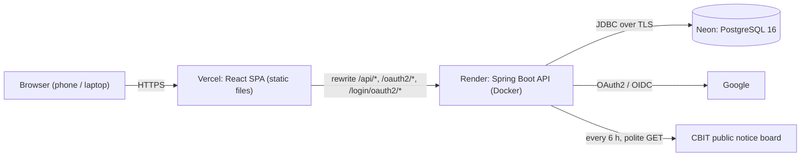

# CampusOA

**An unofficial, student-run placement-prep platform for CBIT students.** It has a drive calendar
built from public CDC circulars, company pages with past CTCs, an eligibility checker, interview
experiences with a searchable question bank, a prep tracker and opt-in leaderboards.

> CampusOA is an independent student project and is not affiliated with or endorsed by CBIT.

| | |
|---|---|
| **Live site** | https://campusoa.vercel.app |
| **API docs (Swagger)** | https://campusoa.vercel.app/api/docs |
| **Backend health** | https://campusoa-api.onrender.com/actuator/health |
| **Source** | https://github.com/Adhrit15/campusoa |
| **CI** | GitHub Actions: backend (unit + Testcontainers), frontend (Vitest + build), Playwright E2E |

<!-- Screenshots: replace these placeholders with real captures (phone + desktop, light + dark). -->
| Drives (phone) | Company page | Prep dashboard |
|---|---|---|
| `docs/screenshots/drives.png` | `docs/screenshots/company.png` | `docs/screenshots/prep.png` |

## Features

- **Drive calendar.** A polite scraper reads the public CDC notice board every 6 hours. It respects
  robots.txt, identifies itself, sends conditional GETs and never downloads the PDFs. Admins link
  companies, add stages (PPT / OA / GD / interview) and merge duplicates. There are list and month
  views, filterable by company, branch and stage.
- **Company pages.** Each shows CTC and offers by year, internship stipends, the selection process,
  linked drives, experiences and questions, and an admin-written "how to prepare" guide. It's seeded
  with public aggregates, all labelled *"Source: CBIT public placement records (approx.)"*.
- **Eligibility checker.** Admins enter each drive's criteria (branches, min CGPA, max backlogs,
  batch). Every student sees **Eligible / Not eligible (with reasons) / Criteria unknown**,
  computed on the server from their **private** profile.
- **Interview experiences and question bank.** Posts are markdown with rounds, difficulty and
  outcome, plus questions tagged by topic. Posting can be anonymous. There are upvotes and comments,
  full-text search (PostgreSQL `tsvector`, stemming, highlighted snippets), and reports with a
  moderation queue. Anything reported 3 times is hidden automatically until reviewed.
- **Prep tracker.** An 8-section roadmap checklist, a DSA problem log, and a dashboard with
  streaks, problems per week and topic coverage.
- **Leaderboards.** Weekly, monthly and all-time, overall or within your branch and batch.
  **Opt-in only.** They're written as hand-written SQL with `RANK` / `DENSE_RANK` / `PARTITION BY`.
- **Admin panel.** Drives, criteria, stages, merges, companies and stats, users and roles, scraper
  runs, plus the moderation queue and audit log.
- Mobile-first UI with a bottom nav, dark mode, an unofficial-project banner on every page, and
  posting guidelines and privacy pages.

## Architecture



**Why the rewrites?** The browser only ever talks to the Vercel domain, so the session cookie is
first-party (Safari and iOS block third-party cookies) and no CORS is needed. REPORT.md §3 and §6
explain this in depth.

| Layer | Tech |
|---|---|
| Backend | Java 21, Spring Boot 3.5 (Web, Security + OAuth2 client, Data JPA, Validation, Actuator), Spring Session JDBC, Flyway, springdoc-openapi, bucket4j, jsoup |
| Database | PostgreSQL 16: 3NF schema, CHECK/FK constraints, partial and GIN indexes, generated `tsvector` columns |
| Frontend | React 19, TypeScript, Vite, React Router, TanStack Query, Tailwind CSS, react-markdown + rehype-sanitize |
| Tests | JUnit 5, Mockito, Testcontainers, MockMvc · Vitest, React Testing Library · Playwright |
| Ops | Docker (multi-stage, layered, non-root JRE), GitHub Actions, Render, Vercel, Neon |

## Run it locally

Prerequisites: **JDK 21**, **Node 22+**, **Docker Desktop** (running).

### Option A: everything in Docker

```bash
docker compose up --build
```

Then open http://localhost:5173 and go to **Sign in → Local dev only** to sign in as a demo user.
You don't need Google credentials for this.

### Option B: run the pieces yourself (faster reloads)

```bash
cp .env.example .env
```

```bash
docker compose up -d db
```

```bash
cd backend && ./mvnw spring-boot:run -Dspring-boot.run.profiles=dev
```

```bash
cd frontend && npm install && npm run dev
```

The `dev` profile loads clearly-labelled demo data (`db/demo/R__demo_data.sql`) and enables the
demo sign-in. Neither exists in production. To try real Google sign-in locally, fill
`GOOGLE_CLIENT_ID` / `GOOGLE_CLIENT_SECRET` and `ALLOWED_EMAIL_DOMAINS` in `.env`.

### Tests

```bash
cd backend && ./mvnw verify
```
Unit tests plus Testcontainers integration tests (Docker required). The coverage report is written to `backend/target/site/jacoco/index.html`.

```bash
cd frontend && npm run typecheck && npm test
```

```bash
cd frontend && npx playwright install chromium && npx playwright test
```
The E2E test needs the backend running with the `dev` profile.

## API overview

All endpoints sit under `/api`. Responses are JSON. Lists are paginated with
`?page=0&size=20` (max 50) and return `{content, page, size, totalElements, totalPages}`. Errors
always look like `{status, error, code, message, fieldErrors[], path, timestamp}`. Interactive docs
are at **/api/docs**.

| Area | Endpoints |
|---|---|
| Me | `GET /me` · `PUT /me/profile` · `DELETE /me` · `POST /auth/logout` |
| Lookups | `GET /branches` · `GET /topics` |
| Drives | `GET /drives?company&branch&stage&from&to&q` · `GET /drives/{id}` · `GET /drives/events?from&to` |
| Companies | `GET /companies?q&sort` · `GET /companies/{slug}` |
| Experiences | `GET/POST /experiences` · `GET/PUT/DELETE /experiences/{id}` · `POST/DELETE /experiences/{id}/vote` · `GET/POST /experiences/{id}/comments` · `DELETE /comments/{id}` |
| Questions | `GET/POST /questions` · `POST/DELETE /questions/{id}/vote` · `DELETE /questions/{id}` |
| Moderation | `POST /reports` · `GET /mod/reports` · `POST /mod/reports/{id}/resolve` · `GET /mod/actions` |
| Prep | `GET /prep/roadmap` · `PUT /prep/roadmap/{itemId}` · `GET/POST /prep/problems` · `DELETE /prep/problems/{id}` · `GET /prep/dashboard` · `GET /leaderboard?period&scope` |
| Admin | `/admin/drives…` (create, edit, merge, criteria, stages) · `/admin/companies…` (edit, placements, internships, stages) · `/admin/users…` (search, role, ban) · `/admin/scraper/runs`, `/admin/scraper/run` |

## Deployment

| Piece | Host | Config |
|---|---|---|
| Frontend | Vercel (free) | `frontend/vercel.json`: SPA fallback, API/OAuth rewrites, security headers |
| Backend | Render (free web service, Docker) | `render.yaml`, `backend/Dockerfile`, `application-prod.yml`. Health check is `/actuator/health`. |
| Database | Neon (free Postgres 16) | Connection string goes into Render's `DATABASE_*` env vars. Flyway migrates on startup. |

Every push to `main` triggers CI. Render and Vercel redeploy automatically. REPORT.md §10 covers
the env vars, free-tier limits (Render sleeps after 15 idle minutes, and the first request then
takes ~1 minute) and how to roll back.

## Docs

- [PLAN.md](PLAN.md): the original plan
- [REPORT.md](REPORT.md) / REPORT.pdf: the full learning report (architecture, DB design, security, tests, interview prep)
- [CONTRIBUTING.md](CONTRIBUTING.md): how to contribute
- [PRIVACY.md](PRIVACY.md): what's stored and how to delete your account

## Résumé bullet

> **CampusOA**: built and deployed a placement-prep platform used by CBIT students (Java 21,
> Spring Boot, PostgreSQL, React/TypeScript). Designed a 3NF schema with full-text search and
> window-function leaderboards, implemented Google OAuth2 with session-based auth, CSRF, role-based
> access and rate limiting, a polite robots.txt-aware scraper, and 100+ automated tests
> (Testcontainers, Vitest, Playwright) in GitHub Actions CI, deployed on Render, Vercel and Neon.
