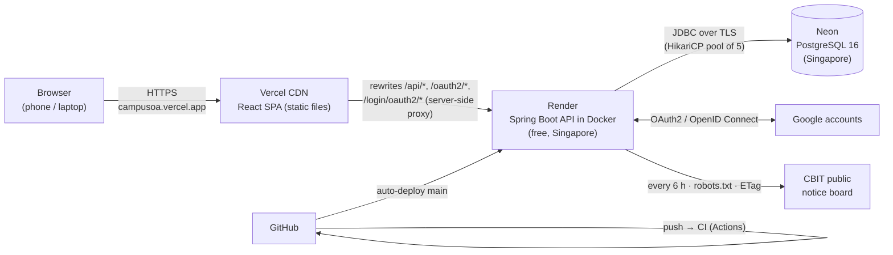
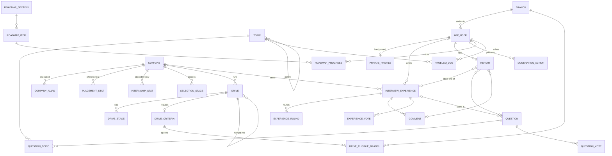
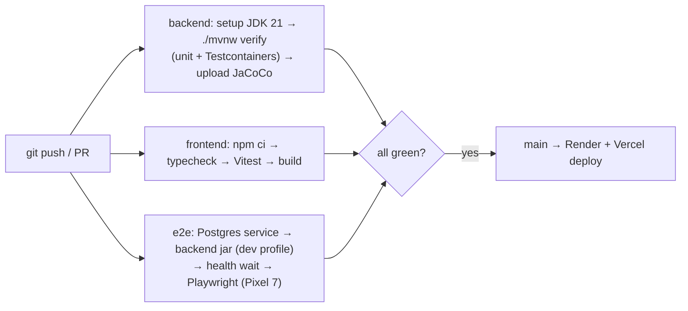

> CampusOA is an independent student project and is not affiliated with or endorsed by CBIT.

**How to read this report.** It's written for a second-year student reading slowly. Every claim
points at a real file, so keep the repo open beside it. If you're short on time, read §1, §3, §5,
§6 and §13 first.

# 1. Executive summary

**What was built.** CampusOA is a full-stack web app that helps CBIT students prepare for
placements:

- a **drive calendar** filled automatically from the public CDC notice board by a polite scraper
- **company pages** with past CTCs, offers and stipends (seeded from public aggregates)
- an **eligibility checker** that compares each drive's criteria with your private profile
- **interview experiences and a question bank** with full-text search, voting, comments, reports
  and a moderation queue
- a **prep tracker** (roadmap, problem log, dashboard with streaks) and opt-in **leaderboards**
  written with SQL window functions
- an **admin panel** for drives, companies, users, the scraper and moderation

**Live URLs**

| | URL |
|---|---|
| Website | https://campusoa.vercel.app |
| API (behind the website) | https://campusoa.vercel.app/api/… (proxied to Render) |
| Swagger UI | https://campusoa.vercel.app/api/docs |
| Health check | https://campusoa.vercel.app/actuator/health is not proxied, so use the Render URL in §10 |
| Source | https://github.com/Adhrit15/campusoa |

**What works (verified).** All MVP features. The automated suite has **108 tests**: 51 backend
unit tests, 38 backend integration tests against a real PostgreSQL 16 in Docker, 19 frontend unit
tests, and 1 Playwright browser test that runs against the real backend. I also clicked through
the app locally as a demo student and a demo admin. I ran the production build against the real
Neon database and confirmed that Flyway migrated it and that the dev-only endpoints are absent.

**What's left or approximate (honest list).**

- Google sign-in is configured, but I could only check it up to the redirect to Google. The full
  login has to be done by a human with a college account (see §10.6).
- Seeded CTC and offer figures are approximate public aggregates, labelled as such everywhere.
- The scraper's company and date parsing is best effort. On the real page it dated 334 of 336
  circulars, and it links a drive to a company only when the name or an alias matches.
  Admins fix the rest.
- Frontend unit-test line coverage is low (17%). Pages are exercised by the E2E test rather than
  unit tests. Backend line coverage is 82%.
- Stretch features (reminders, mock OA, insights charts) aren't built. They're listed as exercises in §14.
- Render's free tier sleeps after 15 idle minutes, so the first request after a nap takes about a minute.

# 2. Build timeline

Times are approximate wall-clock times, including waiting for downloads.

| # | Commit | What changed | Problems hit (and how they were fixed) |
|---|---|---|---|
| M0 | `8befdad` | PLAN.md, .gitignore | The machine had no JDK, Docker or GitHub CLI. I installed them with `winget`. Docker then failed with `open //./pipe/dockerDesktopLinuxEngine: The system cannot find the file specified` because WSL 2 wasn't installed. You ran `wsl --install` and rebooted. *Lesson:* Docker Desktop on Windows is a Linux VM underneath. |
| M1 | `eb97c73` | Spring Boot skeleton, Maven Wrapper, Flyway, actuator, OpenAPI, `ApiError` + `GlobalExceptionHandler`, `PageResponse`, Testcontainers base class, compose, `.env.example` | **Dead end:** I tried to generate the project with Spring Initializr, but it now offers only Boot 4.x. I kept only its Maven Wrapper files and hand-wrote `pom.xml` for **Boot 3.5.16** (found by querying Maven Central's metadata). The first Testcontainers run took ~110 s to pull `postgres:16-alpine`. (~45 min) |
| M2 | `76e0faf` | Migrations V1–V4: schema, reference data, company aggregates, Spring Session tables. `MigrationIT`. | I copied Spring Session's DDL out of its jar so Flyway owns *all* schema. (~40 min) |
| M3 | `dd34c80` | Google OIDC login, domain allow-list, roles, JDBC sessions, SPA CSRF, CORS, CSP, rate limiting, `/api/me`, account deletion, admin role and ban endpoints | Spring Security 6.5 has no `csrf().spa()` shortcut (it's new in 7.x), so I implemented the reference-docs handler myself in `auth/SpaCsrf.java`. All 34 tests passed on the first run. (~60 min) |
| M4 | `218ee43` | Company pages (LATERAL-join SQL), drives, stages, criteria, merge, calendar events, pure `Eligibility` | **Bug 1:** `academic_year char(7)` failed Hibernate's `ddl-auto: validate`, which expected `varchar`. No persistent database had run V1 yet, so I edited it in place. After the first deploy the rule is *never edit an applied migration*. **Bug 2:** a Java text block strips common leading whitespace, which silently removed the space in `" AND (NOT EXISTS …"`. The SQL became `d.hiddenAND(...)`, and Postgres answered `schema "d" does not exist`. An integration test caught it. (~75 min) |
| M5 | `bafc335` | robots.txt parser, jsoup notice-board parser, title analyser, conditional GET, scheduler, admin run history | I fetched the real page **once** with an identifying User-Agent to learn its layout. A dry run of the parser against that saved copy dated 331/336 titles. Titles like "01 & 03 October-2026" use month names, so I added that pattern, which got it to 334/336. The 2 left have no date at all. **Also:** a nested-heredoc shell command silently failed to write files, so I switched to the editor tool. (~60 min) |
| M6 | `d65ed9d` | Experiences, rounds, question bank, votes, comments, full-text search, reports, auto-hide, moderation queue, audit log, rate-limit test | A test helper named `post(...)` shadowed MockMvc's static `post(url)`, which caused a compile error. I renamed it `postExperience`. (~70 min) |
| M7 | `5e9962e` | Roadmap, problem log, dashboard (FILTER, generate_series), streaks, window-function leaderboards | All passed on the first run. (~45 min) |
| — | `f9a8b7e` | Demo seed data and dev-only demo login | The local UI needed a way to sign in without Google credentials. `DevLoginController` exists only in the `dev` profile, and a test proves it returns 404 elsewhere. |
| M8–10 | `c3aa393` | React frontend: every page, admin panel, dark mode, mobile nav | npm 11 blocked esbuild's install script, but Vite worked anyway through the platform binary package. Running it locally showed the experience cards printing raw markdown (`## Preparation`), so I added `stripMarkdown`. The browser pane couldn't take screenshots (the window was in the background), so I verified pages through their text and through `fetch` calls. (~2.5 h) |
| M11 | `c85b134` | Vitest + RTL tests, Playwright E2E, GitHub Actions | `npm run build` failed on a test file's `unknown` type (`tsc` checks tests too). Fixed with a cast. (~40 min) |
| M12 | `1f04b88` | Dockerfile, render.yaml, vercel.json, `PublicUrlFilter`, README, CONTRIBUTING, PRIVACY | **The important catch:** behind Vercel's proxy, Spring would rebuild the OAuth callback URL with Render's hostname. Spring Security compares that URL with the `redirect_uri` it sent Google, so every login would have failed. `PublicUrlFilter` pins scheme, host and port to `APP_PUBLIC_URL`. (~50 min) |
| — | `43786ed` | Vercel CLI files ignored | The Vercel CLI created `frontend/.env.local`. It's ignored by both `.gitignore` files. |
| — | `0c30861` | `fix(ci)` | The **first CI run failed**: `./mvnw: Permission denied`. Git on Windows had committed `mvnw` without the executable bit. Fixed with `git update-index --chmod=+x backend/mvnw`. |
| CP4 | *(see §10.6)* | Deployment verification and URLs | |

# 3. Architecture

## 3.1 System diagram



The browser **never talks to Render directly**. Vercel's rewrites make the API appear to live at
`campusoa.vercel.app/api`, which gives us:

1. **First-party cookies.** The session cookie belongs to `campusoa.vercel.app`. iOS Safari blocks
   third-party cookies, and most of our users are on iPhones and Androids.
2. **No CORS in normal use.** It's all one origin. CORS is still configured as defence in depth.
3. **One URL to give Google** as the OAuth redirect.

## 3.2 Walkthrough: "a student posts an interview experience"

Follow one request through every layer.

**① Form (browser).** `frontend/src/pages/NewExperiencePage.tsx`. On submit, `validateExperience(form)`
(line 62) checks the same rules as the server for instant feedback: body ≥ 50 characters, guidelines
accepted, each question tagged. Then the `useMutation` at line 51 calls
`api.post('/api/experiences', body)`.

**② API client.** `frontend/src/api/client.ts`. `request()` adds `Content-Type: application/json`
and, because this is a write, copies the `XSRF-TOKEN` cookie into an `X-XSRF-TOKEN` header
(line 43). `fetch` sends the request to the *same origin* with the session cookie attached
automatically.

**③ Vercel.** `frontend/vercel.json` matches `/api/:path*` and proxies the request to
`https://<render-service>.onrender.com/api/experiences`, passing along cookies and headers.

**④ Spring filter chain (Render).** Before any controller code runs:

- `PublicUrlFilter` makes the request look as if it arrived at `https://campusoa.vercel.app`.
- The **CSRF filter** compares the header token with the cookie token. If they don't match, the
  answer is **403** and nothing else happens.
- **Spring Session** loads the session row from `SPRING_SESSION`, using the `SESSION` cookie, and
  deserialises our `AppUserPrincipal` (user id and role).
- **Authorisation** applies `SecurityConfig.java` line 65: `/api/**` requires authentication.
  Signed-out users get the JSON 401 from the `authenticationEntryPoint`.

**⑤ Rate limiter.** `config/RateLimitInterceptor.java` line 45 (`preHandle`). The user's token
bucket loses one token. An empty bucket means **429** with `Retry-After`.

**⑥ Controller.** `experience/ExperienceController.java` line 57. `@Valid @RequestBody
ExperienceRequest` deserialises the JSON into a record and runs Bean Validation (`@NotBlank`,
`@Size(min=50)`, `@AssertTrue acceptGuidelines` …). A violation throws
`MethodArgumentNotValidException`, which `GlobalExceptionHandler` (line 40) turns into a
**400** with `fieldErrors`. `@AuthenticationPrincipal` hands the controller the signed-in user.

**⑦ Service, in one transaction.** `experience/ExperienceService.java` line 109, `create()`, is
`@Transactional`:

- `requireCompany` checks the company exists (line 110).
- It builds an `InterviewExperience` with its `ExperienceRound`s. These are a cascading
  `@OneToMany`, so saving the parent saves the children.
- `experiences.save(e)` runs at line 113.
- `questions.createAll(...)` (line 115, in `question/QuestionService.java` line 70) resolves topic
  codes to `Topic` rows, rejecting unknown ones, and saves each `Question`. JPA writes the
  `question_topic` junction rows.
- If *anything* throws, the whole transaction rolls back: no half-saved post.

**⑧ Repository and database.** Spring Data JPA (`InterviewExperienceRepository`) has Hibernate
generate the `INSERT`s. Postgres enforces the CHECK constraints (difficulty 1–5, body ≤ 20 000
characters) and foreign keys, and **computes `search_vector` itself** from the generated-column
definition (`V1__schema.sql` line 183). The GIN index (line 188) is updated in the same
transaction, so the post is searchable immediately.

**⑨ Response.** The controller re-reads the post through `service.detail(id, viewer)`. That
applies the anonymity rule in one place (`ExperienceService.authorFor`). It returns **201
Created** with a `Location: /api/experiences/{id}` header and the `ExperienceDetailDto` JSON.

**⑩ Back in the browser.** `onSuccess` invalidates the `['experiences']` query cache, so lists
refetch, and navigates to `/experiences/{id}`. That page renders the body through `<Markdown>`,
which sanitises HTML (§6.8).

# 4. Codebase tour

```
campusoa/
├─ PLAN.md, README.md, REPORT.md, CONTRIBUTING.md, PRIVACY.md
├─ docker-compose.yml        local stack: db (+ backend + frontend with --build)
├─ render.yaml               Render blueprint (backend service + env var names)
├─ .env.example              every env var, documented (copy to .env)
├─ .github/workflows/ci.yml  CI: backend, frontend, e2e jobs
├─ backend/
│  ├─ pom.xml                dependencies + JaCoCo + Failsafe (*IT tests)
│  ├─ mvnw, .mvn/            Maven Wrapper: no global Maven install needed
│  ├─ Dockerfile             multi-stage, layered, non-root production image
│  └─ src/main/java/in/campusoa/
│     ├─ CampusOaApplication.java   entry point
│     ├─ config/   SecurityConfig, AppProperties (typed app.* config), CoreConfig (Clock,
│     │            OpenAPI), RateLimitInterceptor, WebConfig, PublicUrlFilter
│     ├─ common/   ApiError, ApiException, GlobalExceptionHandler, PageResponse, PageParams,
│     │            Slugs, Viewer, ContentStatus, Votes (vote SQL shared by two features)
│     ├─ auth/     AppUserPrincipal, CampusOidcUserService, EmailDomainPolicy,
│     │            LoginRejectedException, SessionRevoker, SpaCsrf, DevLoginController (dev only)
│     ├─ user/     AppUser, PrivateProfile, Branch, Role, repositories, UserService,
│     │            MeController, UserDtos
│     ├─ company/  Company (+ CompanyChildren: alias, placement/internship stats, stages),
│     │            CompanyQueries (SQL), CompanyService, CompanyController, CompanyDtos
│     ├─ drive/    Drive, DriveStage, DriveCriteria, Eligibility (pure rules), DriveQueries,
│     │            DriveService, DriveController, DriveDtos, StageType
│     ├─ scraper/  NoticeBoardScraper, NoticeBoardParser, TitleAnalyzer, RobotsTxt,
│     │            HttpFetcher (+ JdkHttpFetcher), ScrapeRun, ScraperScheduler,
│     │            AdminScraperController
│     ├─ experience/  InterviewExperience, ExperienceRound, Comment, ExperienceQueries,
│     │               ExperienceService, ExperienceController, ExperienceDtos
│     ├─ question/    Question, Topic, QuestionQueries, QuestionService, QuestionController
│     ├─ moderation/  Report + ModerationAction (entities), ContentTarget, ModerationQueries,
│     │               ModerationService, ModerationController
│     ├─ prep/        ProblemLog, Streaks (pure), PrepQueries, LeaderboardQueries,
│     │               PrepService, PrepController, PrepDtos
│     └─ admin/       AdminUserController
│  └─ src/main/resources/
│     ├─ application.yml / -dev.yml / -prod.yml   config per environment
│     ├─ db/migration/V1..V4__*.sql               schema + reference data (all envs)
│     └─ db/demo/R__demo_data.sql                 demo data (dev profile only)
│  └─ src/test/…    *Test = unit (Mockito), *IT = integration (Testcontainers)
└─ frontend/
   ├─ package.json, vite.config.ts (dev/preview proxy + Vitest), tsconfig.json
   ├─ tailwind.config.js, postcss.config.js, index.html, public/
   ├─ vercel.json            production rewrites + security headers
   ├─ playwright.config.ts, e2e/smoke.spec.ts
   └─ src/
      ├─ main.tsx            QueryClient + Router providers
      ├─ App.tsx             route table (admin is lazy-loaded)
      ├─ api/                client.ts (fetch + CSRF + errors), hooks.ts (TanStack Query), types.ts
      ├─ components/         Layout (banner, nav, footer), RequireAuth, EligibilityBadge,
      │                      Markdown/Highlight, VoteButton, ReportButton, ThemeToggle, ui.tsx
      ├─ pages/              one file per screen; admin/ for the admin panel
      ├─ lib/format.ts       dates in IST, ₹ formatting, labels
      └─ test/               setup + render/fetch helpers
```

**Why feature packages?** The alternative is layer packages (`controllers/`, `services/` …).
Feature folders keep everything about drives in one place, so a classmate can work on `prep/`
without touching anything else. Inside each feature the layering is still controller → service →
repository.

**Why are some classes package-private** (for example `PlacementStat`)? Only the `company` package
may touch those entities. Other packages get DTOs. Java's access modifiers enforce the boundary
for us.

# 5. Database design

## 5.1 ERD



## 5.2 Tables and why each exists

| Table | Purpose | Notable design choices |
|---|---|---|
| `branch` | The 12 branches | A **lookup table, not an enum**, so a new branch is a row rather than a code change. Its PK is the natural code (`CSE`). |
| `app_user` | One per Google account | `email` is UNIQUE with a `CHECK (email = lower(email))`, so case variants can't create duplicates. `google_sub` is Google's permanent id (emails can change). `leaderboard_opt_in` defaults to **false**. |
| `private_profile` | CGPA and backlogs | A **separate 1:1 table** with the same PK as `app_user` and `ON DELETE CASCADE`. A query has to JOIN it deliberately, so a public author query can never leak CGPA. |
| `company` | Recruiters | `slug` is UNIQUE with a regex CHECK, for readable URLs. |
| `company_alias` | "JPMC", "LTM" … | A **unique index on `lower(alias)`** (a functional index) gives case-insensitive uniqueness. |
| `placement_stat` | Offers per company, year and role | `UNIQUE(company_id, academic_year, role_title)`. "Up to 9.5 LPA" is `ctc_min NULL, ctc_max 9.5`, and a CHECK enforces `min ≤ max`. |
| `internship_stat` | Stipend per company and year | UNIQUE(company, year), so the admin endpoint is an upsert. |
| `selection_stage` | Usual process per company | UNIQUE(company, position). |
| `drive` | One circular or event | `pdf_url` UNIQUE is the scraper's dedupe key. `merged_into_id` is a self-FK with `CHECK (merged_into_id <> id)`. `company_id` is nullable for unmatched scrapes, with `company_guess` kept for admins. |
| `drive_stage` | Scheduled steps | `starts_at timestamptz` (an instant). The calendar converts it to IST dates. |
| `drive_criteria` | Eligibility rules | One optional row per drive. **No row means "criteria unknown"**: absence carries meaning without a nullable flag. |
| `drive_eligible_branch` | Which branches | A junction table, because a `"CSE,IT"` string would break **1NF**. No rows for a drive *with* criteria means "all branches". |
| `interview_experience` | Posts | `status` is PUBLISHED, HIDDEN or REMOVED. `author_id ON DELETE SET NULL` keeps posts when accounts are deleted. `search_vector` is a **generated stored column**. |
| `experience_round` | Rounds of a post | UNIQUE(experience, position). It cascades with its parent. |
| `question`, `topic`, `question_topic` | Question bank | `topic` is self-referencing (DSA → Graphs). Many-to-many through a junction table. |
| `experience_vote`, `question_vote` | Upvotes | The **composite PK (target, user)** enforces one vote per person, even when two requests race. |
| `comment` | Comments | |
| `report` | Moderation reports | Three nullable FKs plus `CHECK (num_nonnulls(experience_id, question_id, comment_id) = 1)`. See §11 D5. |
| `moderation_action` | Audit log | Append-only. `moderator_id NULL` means automatic. |
| `roadmap_section`, `roadmap_item`, `roadmap_progress` | Checklist | Progress PK is (user, item), so ticking twice is a no-op (`ON CONFLICT DO NOTHING`). |
| `problem_log` | Solved problems | `UNIQUE(user_id, url)` prevents padding the leaderboard. |
| `scrape_run` | Scraper history | Stores ETag/Last-Modified for conditional requests. |
| `spring_session*` | HTTP sessions | Spring Session's own schema, created by Flyway V4. |

## 5.3 Normalisation decisions

- **1NF** (atomic values, no repeating groups): branches, topics and rounds each get their own rows
  (`drive_eligible_branch`, `question_topic`, `experience_round`) rather than comma-separated or
  JSON columns.
- **2NF** (no partial dependency on part of a composite key): in `question_topic(question_id,
  topic_id)` no column depends on only one of the two. The topic's *name* lives in `topic`,
  not in the junction table.
- **3NF** (no transitive dependency): a drive stores `company_id`, never the company *name*. The
  name depends on the company, not the drive. Likewise posts store `author_id`, and the
  display name lives in `app_user`.
- **Deliberate non-normalised data:** `drive.company_guess` duplicates text that might match a
  company. It exists only while `company_id` is NULL, and the service clears it when an admin links
  a company. Vote and comment **counts are computed, not stored**, which avoids update anomalies;
  §14 has an exercise on when caching them would be worth it.

## 5.4 Every index and the query it serves

| Index | Query it serves |
|---|---|
| `ix_drive_visible_notice_date (notice_date DESC) WHERE merged_into_id IS NULL AND NOT hidden` | Drive list and calendar. It's **partial**: it indexes only the rows the list can show, so it stays small. |
| `ix_drive_company (company_id)` | Company page "drives for this company", and FK lookups |
| `ix_drive_stage_drive`, `ix_drive_stage_starts_at` | Loading stages for a page of drives, and calendar month ranges |
| `ix_drive_eligible_branch_branch (branch_code)` | The branch filter's `EXISTS (... b.branch_code = :branch)` |
| `ix_company_alias_lower` (unique, functional) | Case-insensitive alias uniqueness |
| `ix_experience_search` **GIN** on `search_vector` | `search_vector @@ query` full-text search |
| `ix_experience_company_published (company_id, created_at DESC) WHERE status='PUBLISHED'` | A company's experiences, newest first |
| `ix_experience_published_created (created_at DESC) WHERE status='PUBLISHED'` | The default experience feed |
| `ix_experience_author`, `ix_question_*`, `ix_comment_experience (experience_id, created_at)` | Author lookups, FK cascades, comment threads in order |
| `ix_question_search` GIN | Question-bank search |
| `ix_question_topic_topic (topic_id)` | "Questions tagged Graphs" (the PK already covers lookups by question) |
| `ix_experience_vote_user`, `ix_question_vote_user` | "Did I vote?" plus fast cascades on account deletion |
| `ix_report_open_queue (created_at) WHERE status='OPEN'` | The moderation queue, oldest first |
| `ix_report_experience/question/comment` (partial) | "Open reports for this item" when checking the auto-hide threshold |
| `ix_problem_log_solved_user (solved_on, user_id)` | Leaderboard: "everyone's solves between :from and :to" (range scan) |
| `ix_problem_log_user_solved (user_id, solved_on DESC)` | Dashboard and streak: "my solves, newest first" |
| `ix_scrape_run_started` | Latest run, for ETag reuse and the 6-hour rule |

*Why both `(solved_on, user_id)` and `(user_id, solved_on)`?* A B-tree index is sorted by its first
column. The leaderboard filters by date across all users, so the date must come first. The
dashboard filters by one user, so the user must come first. One index can't serve both
efficiently.

## 5.5 The leaderboard SQL, line by line

From `prep/LeaderboardQueries.java`:

```sql
WITH solved AS (                                         -- (1)
    SELECT p.user_id, count(*) AS solved
    FROM problem_log p
    WHERE p.solved_on >= :from AND p.solved_on < :to      -- (2)
    GROUP BY p.user_id
),
ranked AS (                                              -- (3)
    SELECT u.id, u.display_name, u.avatar_url, u.branch_code, u.grad_year, s.solved,
           RANK()       OVER (ORDER BY s.solved DESC)                                  AS overall_rank,   -- (4)
           DENSE_RANK() OVER (ORDER BY s.solved DESC)                                  AS overall_dense,  -- (5)
           RANK()       OVER (PARTITION BY u.branch_code, u.grad_year ORDER BY s.solved DESC) AS cohort_rank, -- (6)
           DENSE_RANK() OVER (PARTITION BY u.branch_code, u.grad_year ORDER BY s.solved DESC) AS cohort_dense
    FROM solved s
    JOIN app_user u ON u.id = s.user_id
    WHERE u.leaderboard_opt_in AND NOT u.banned          -- (7)
)
SELECT * FROM ranked
WHERE branch_code = :branch AND grad_year = :year        -- (8) only for the cohort view
ORDER BY cohort_rank, display_name, id                   -- (9)
LIMIT :limit OFFSET :offset;                             -- (10)
```

1. **CTE (`WITH`)**: a named subquery, which makes the query readable top to bottom.
2. **Half-open range** `[from, to)`. For "this week", `from` is Monday and `to` is next Monday, so
   there's no off-by-one at midnight. Java computes the Monday in IST (`PrepService.leaderboard`).
   This predicate uses `ix_problem_log_solved_user`.
3. Rank only the people who may appear.
4. **`RANK()`**: ties share a rank and the next rank skips. With 5, 5, 3 problems the ranks are
   **1, 1, 3**.
5. **`DENSE_RANK()`**: ties share a rank with no gap: **1, 1, 2**. We return both, and the UI
   shows RANK.
6. **`PARTITION BY`** restarts the ranking for each (branch, year) group. *One* query gives your
   overall rank **and** your rank within CSE 2027. A window function **doesn't collapse rows** the
   way `GROUP BY` does. It adds a column computed over a "window" of related rows.
7. Privacy is enforced in SQL: opted-out and banned users never get a rank.
8. **Why filter outside the CTE?** In SQL's logical order of evaluation, window functions run
   *after* `WHERE`. If we filtered to CSE 2027 inside `ranked`, the overall ranks would be computed
   among CSE 2027 only. Ranking first and filtering afterwards keeps both correct.
9. A deterministic tie-break order (name, then id) makes pagination stable.
10. Pagination. `PageParams` clamps size to ≤ 50.

`PrepIT.rankVsDenseRankWithTiesAndOptOut` and `cohortRankingIsPartitionedByBranchAndYear` test
exactly these behaviours against real Postgres.

## 5.6 Full-text search, explained

```sql
-- V1__schema.sql: Postgres maintains this column itself on every INSERT/UPDATE
search_vector tsvector GENERATED ALWAYS AS (
    setweight(to_tsvector('english', coalesce(role_title, '')), 'A') ||
    setweight(to_tsvector('english', coalesce(body_md, '')), 'B')
) STORED
```

- `to_tsvector('english', text)` lowercases the text, drops stop-words ("the", "and") and
  **stems** each word. "memoization" becomes `memoiz`, so a search for "memoize" finds it.
- `setweight(..., 'A')` marks words from the role title as more important than body words ('B').
- A **GIN** (Generalized Inverted Index) maps each lexeme to the rows containing it, the way a
  book's index maps words to pages.

The query (`experience/ExperienceQueries.java`):

```sql
SELECT ..., ts_headline('english', e.body_md, query, 'StartSel=[[, StopSel=]], MaxWords=35, MinWords=15')
FROM interview_experience e
JOIN company c ON c.id = e.company_id
CROSS JOIN websearch_to_tsquery('english', :q) AS query     -- parse the user's text once
WHERE e.status = 'PUBLISHED' AND e.search_vector @@ query   -- @@ = "matches", uses the GIN index
ORDER BY ts_rank(e.search_vector, query) DESC, e.created_at DESC
```

- `websearch_to_tsquery` understands Google-style input: `"linked list" -array or dp`.
- `ts_rank` scores matches. Weight A hits count more.
- `ts_headline` builds a snippet with the matches wrapped in `[[ ]]`. The React `Highlight`
  component turns those into `<mark>`. We send plain-text markers rather than HTML on purpose,
  to avoid XSS.
- `CommunityIT.fullTextSearchStemsWordsAndHighlights` proves stemming and highlighting work.

# 6. Auth & security explained

## 6.1 How Google sign-in (OAuth 2.0 + OpenID Connect) works

```mermaid
sequenceDiagram
    autonumber
    participant B as Browser
    participant V as Vercel (proxy)
    participant S as Spring Boot (Render)
    participant G as Google
    participant DB as Postgres (Neon)
    B->>V: GET /oauth2/authorization/google
    V->>S: (proxied)
    S->>DB: save session (state, nonce, PKCE verifier)
    S-->>B: 302 to accounts.google.com/...?client_id&redirect_uri&state&code_challenge
    B->>G: user picks college account, consents
    G-->>B: 302 to campusoa.vercel.app/login/oauth2/code/google?code=...&state=...
    B->>V: GET /login/oauth2/code/google?code&state
    V->>S: (proxied, with SESSION cookie)
    S->>S: check state matches session (blocks login CSRF)
    S->>G: POST /token (code + client_secret + PKCE verifier) [server-to-server]
    G-->>S: id_token (signed JWT: sub, email, email_verified, name) + access_token
    S->>S: verify id_token signature (Google's public keys), issuer, audience, nonce, expiry
    S->>S: CampusOidcUserService: domain allow-list? banned? create/update app_user, role
    S->>DB: new session id; store SecurityContext (AppUserPrincipal)
    S-->>B: 302 to / with Set-Cookie: SESSION=...; HttpOnly; Secure; SameSite=Lax
    B->>V: GET /api/me (cookie sent automatically)
    V->>S: (proxied)
    S-->>B: 200 {id, role, ...}
```

The key points:

- **The browser never sees the client secret or Google's tokens.** The code-for-token exchange
  (step 11) happens server-to-server.
- **`state`** ties the callback to the browser that started the flow, which stops an attacker from
  logging you into *their* account (login CSRF). **PKCE** and the **nonce** stop a stolen `code` or
  `id_token` from being replayed.
- **Our rules** live in `auth/CampusOidcUserService.java` and `user/UserService.registerLogin`:
  the email must be verified and its domain must be on `ALLOWED_EMAIL_DOMAINS` (an exact match, so
  `evil-cbit.ac.in` fails). Banned users are rejected. `ADMIN_EMAILS` promote. A rejection
  redirects to `/login?error=domain_not_allowed`, and so on.
- After login, Spring **changes the session id** (session-fixation protection).

## 6.2 Sessions vs JWT: why sessions here

| | Server session (chosen) | JWT in the browser |
|---|---|---|
| What the browser holds | A random id in an **HttpOnly** cookie | A signed token, often in `localStorage` |
| XSS steals it? | No. JavaScript can't read HttpOnly cookies. | If it's in `localStorage`, yes |
| Revoke now (ban, role change)? | **Yes.** Delete the row (`SessionRevoker`). | No. It stays valid until it expires, unless you add a blocklist (which is just state again). |
| Server state | One DB row per session | None, until you need revocation and refresh tokens |
| Survives restarts? | Yes, because it's stored in Postgres (Spring Session JDBC) | Yes |
| Best for | Browser apps on one origin | Mobile apps, many services, third-party API clients |

Our users are browsers on one origin, so sessions are simpler *and* safer. The cost is one
indexed lookup per request. Render's free tier restarts often, which is why sessions live in
Postgres and not in memory. `SessionRevoker` uses Spring Session's
`findByPrincipalName(userId)`, which is why `AppUserPrincipal.getName()` returns our user id.

## 6.3 CSRF (Cross-Site Request Forgery)

**The attack.** You're signed in. You visit `evil.com`, which contains
`<form action="https://campusoa.vercel.app/api/me" method="POST">` and auto-submits it. The browser
attaches your cookie, so without protection the server would act as you.

**The defence (double-submit cookie).** `CookieCsrfTokenRepository` puts a random token in a
cookie named `XSRF-TOKEN`. Unlike the session cookie, JavaScript *can* read this one. Our client
copies it into the `X-XSRF-TOKEN` header. `evil.com` can make your browser *send* the cookie,
but the same-origin policy stops it from *reading* the value, so it can't produce the header.
`SameSite=Lax` on the session cookie is a second layer: browsers don't send it on cross-site
POSTs at all. `SpaCsrf.java` adds Spring's recommended SPA handler, and
`AuthIT.writesWithoutCsrfTokenAreRejected` proves a missing token means 403.

## 6.4 CORS (Cross-Origin Resource Sharing)

CORS is the browser's rule for *reading responses* from another origin. Because Vercel proxies
the API, production traffic is same-origin and CORS never comes into play. We still configure
it (`SecurityConfig.corsConfigurationSource`) to allow **only** `FRONTEND_ORIGIN` with
credentials, so a hypothetical direct call from another site would be blocked. Note that **CORS
doesn't stop CSRF**: the browser still *sends* a cross-origin form POST. That's why we need both.

## 6.5 Role checks: defence in depth

1. **URL rules** in `SecurityConfig`: `/api/admin/**` needs ADMIN and `/api/mod/**` needs MODERATOR.
   Admins hold every role up to their own (`AppUserPrincipal.getAuthorities`). `/api/**` needs
   login. Anything not listed is **denied** (`anyRequest().denyAll()`).
2. **`@PreAuthorize`** on every admin and moderator controller, so a future URL change can't
   silently open them.
3. **Ownership checks** in services: only the author can edit or delete a post
   (`ExperienceService.ownedBy`). Problem-log reads and deletes use `findByIdAndUserId`, so you can
   never touch someone else's row. This prevents **IDOR** (Insecure Direct Object Reference:
   guessing ids). It answers 404 rather than 403, so we don't even confirm the row exists.
4. **Private-field isolation**: `AuthorDto` and `AdminUserDto` have no CGPA field at all. The
   test `adminListsUsersWithoutPrivateFields` asserts it.
5. The **frontend** `RequireAuth` only hides pages for UX. It isn't security. The server always
   decides.

## 6.6 Rate limiting

`RateLimitInterceptor` gives each user (or IP, when signed out) a **token bucket**. It holds N
tokens (`RATE_LIMIT_WRITES_PER_MINUTE`, default 30) and refills N per minute. Each
POST/PUT/DELETE spends one, and an empty bucket returns **429 + `Retry-After`**. Reads are never
limited. It slows spam bots, scripted vote-stuffing and accidental infinite loops in the frontend.
It's in memory, which is fine for one instance. With several, you'd use Redis (an exercise in §14).
`RateLimitIT` proves the fourth write in a minute fails, and that another user is unaffected.

## 6.7 Input validation, at two layers

- **Bean Validation** on request records (`@NotBlank`, `@Size`, `@Pattern`, `@DecimalMax("10.00")`
  …) gives friendly 400s with `fieldErrors`.
- **Database constraints** (CHECK, UNIQUE, FK) are the last line of defence if code has a bug.
  `GlobalExceptionHandler` maps their violations to 409.
- All SQL uses **bound parameters** (`:name`), never string concatenation of user input, which
  prevents **SQL injection**. The few places that build SQL strings insert only constants (sort
  clauses, enum-mapped table names). The comments in `Votes` and `CompanyQueries` explain this.

## 6.8 XSS (Cross-Site Scripting)

Users write markdown. If we rendered it as raw HTML, a post containing `<script>` or
`` would run in every reader's browser. `components/Markdown.tsx` uses
`react-markdown` (never `dangerouslySetInnerHTML`) with **`rehype-sanitize`** (an allow-list).
Links get `rel="noopener noreferrer nofollow"`. A unit test feeds it `<script>`, `onerror` and
`javascript:` and asserts all are gone. On top of that, `vercel.json` sets a strict
**Content-Security-Policy** (`script-src 'self'`, no inline scripts), so even an injected script
tag couldn't execute. That's also why the dark-mode bootstrap lives in `/theme-init.js` rather
than inline in `index.html`.

## 6.9 Other protections

`X-Content-Type-Options: nosniff`, `Referrer-Policy`, `Strict-Transport-Security` (HTTPS only),
`frame-ancestors 'none'` (stops clickjacking), a non-root Docker user, and secrets only in env vars
(`.env` is git-ignored, and a scan before publishing found none in history). The dev-login endpoint
exists only under `@Profile("dev")`, and a test proves it returns 404 otherwise.

## 6.10 The scraper's ethics

It identifies itself (`SCRAPER_USER_AGENT`), obeys robots.txt using RFC 9309 longest-match rules,
runs at most every 6 hours, uses ETag and If-Modified-Since (a 304 costs the site almost nothing),
makes one request per run, never downloads the PDFs, and so never ingests student data.

# 7. REST API design

**Conventions.** Nouns as resources (`/experiences/{id}`), HTTP verbs for actions, JSON bodies,
and `/api` as the prefix for everything. Sub-resources express ownership
(`/experiences/{id}/comments`). Actions that aren't plain CRUD become sub-resources
(`/drives/{id}/merge`, `/mod/reports/{id}/resolve`).

**Endpoint table.** It's in the README ("API overview"), and live with try-it-out buttons at
`/api/docs` (springdoc generates it from the controllers).

**Status codes used**

| Code | When |
|---|---|
| 200 OK | Successful read or update returning a body |
| 201 Created | POST created something. Includes a `Location` header. |
| 204 No Content | Successful delete, vote or tick with nothing to return |
| 400 Bad Request | Validation failed (`VALIDATION_FAILED` + `fieldErrors`), malformed JSON, or a business rule (`OWN_POST`, `UNKNOWN_TOPIC` …) |
| 401 Unauthorized | Not signed in (`UNAUTHENTICATED`) |
| 403 Forbidden | Signed in but wrong role or owner, or a missing CSRF token |
| 404 Not Found | Doesn't exist, **or you may not know it exists** (hidden posts, other people's problems) |
| 409 Conflict | Duplicate (already reported, company exists) or a DB constraint violation |
| 429 Too Many Requests | Rate limited (`RATE_LIMITED`, `Retry-After`) |
| 500 | Unexpected. Logged with the stack trace, but the client sees only a generic message. |

**Pagination.** `?page=0&size=20` (size is clamped to 50). The response is
`{content, page, size, totalElements, totalPages}` (`common/PageResponse`). We don't expose
Spring's `Page` JSON because its shape is an internal detail.

**Error format.** It's always the same shape (`common/ApiError`), so the frontend has one parser
(`ApiError` in `client.ts`):

```json
{ "status": 400, "error": "Bad Request", "code": "VALIDATION_FAILED",
  "message": "Request has invalid fields",
  "fieldErrors": [{ "field": "bodyMd", "message": "must be 50–20000 characters" }],
  "path": "/api/experiences", "timestamp": "2026-11-20T10:00:00Z" }
```

`code` is machine-readable (the UI switches on it). `message` is for humans.

# 8. Frontend architecture

- **Routing.** React Router in declarative mode (`App.tsx`). `Layout` wraps every page with the
  unofficial-project banner, the header, the **bottom nav on phones** (`md:hidden`), and the footer
  disclaimer. `RequireAuth` guards signed-in pages. The admin area is **lazy-loaded**
  (`React.lazy`), so students never download its code. Filters live **in the URL** (`?stage=OA`),
  so views can be shared and the back button works.
- **Server state is TanStack Query.** Every API read is a hook in `api/hooks.ts` with a **query
  key** (`['drives', filters]`). The library caches per key, de-duplicates identical requests, keeps
  data "fresh" for 30 s, retries network errors (helpful during Render cold starts) but not
  4xx, and uses `keepPreviousData` so pagination doesn't flash. After writes, mutations
  **invalidate** keys. For example, saving your profile invalidates `drives`, `calendar` and
  `leaderboard` because eligibility and cohort depend on it.
- **Optimistic updates.** Ticking a roadmap item (`useTickRoadmap`) or voting (`VoteButton`)
  updates the UI immediately and rolls back if the server says no. It feels instant on slow
  mobile networks.
- **Client state** is plain `useState`: form fields and the selected tab. There's no Redux,
  because server data is already in the Query cache and very little else is global. The theme is
  a class on `<html>`, remembered in `localStorage`.
- **Components.** `ui.tsx` holds small building blocks (`QueryState` renders loading, error or
  content in one line, plus `Pagination` and `Field`). Feature components (`EligibilityBadge`,
  `VoteButton`, `ReportButton`, `Markdown`) are reused across pages. Pages export their card
  components (`DriveCard`, `ExperienceCard`, `QuestionCard`) so the company page reuses them.
- **Styling.** Tailwind utility classes, plus a handful of component classes in `index.css`
  (`card`, `btn-primary`, `input`). Dark mode uses `darkMode: 'class'` with `dark:` variants.
  The layout is mobile-first: base styles target phones, and `sm:`/`md:` add columns on larger
  screens.
- **Types.** `api/types.ts` mirrors the Java DTOs. `tsc --noEmit` runs in CI and in `npm run build`.

# 9. Testing

| Suite | Tool | Count | What it covers |
|---|---|---|---|
| Backend unit | JUnit 5 + Mockito | 51 | `Eligibility` rules (8), `EmailDomainPolicy` (12), `UserService` login rules with mocked repositories (5), `Streaks` (5), scraper parser, titles and robots.txt (20), `PublicUrlFilter` (1) |
| Backend integration | Testcontainers + MockMvc | 38 | Migrations and constraints, health/OpenAPI, auth/roles/CSRF/privacy (12), drives and eligibility end to end (7), community and moderation (6), scraper with a fake website (2), prep and the **leaderboard SQL** (4), rate limiting (1) |
| Frontend unit | Vitest + React Testing Library | 19 | API client (CSRF header, errors, 204), formatters, markdown sanitising (XSS), highlight, eligibility badge, drive list and filters, roadmap checklist, form validation, route guards |
| End to end | Playwright (Pixel 7 viewport) | 1 | Home → drives (list and calendar) → company page, against the production build and a real backend |

**How Testcontainers works.** `support/IntegrationTest.java` declares a static
`PostgreSQLContainer("postgres:16-alpine")` and starts it once. Testcontainers talks to Docker,
starts a throwaway Postgres on a random port, and waits until it accepts connections.
`@ServiceConnection` tells Spring Boot to point the DataSource at it, overriding `DATABASE_URL`.
Flyway then runs **the real migrations**, so every integration run also tests the migrations.
Because the container is static, all test classes share one database. Tests therefore create their
own uniquely named users (`TestUsers.create`) instead of assuming an empty DB. Why not H2
(an in-memory database)? H2 doesn't support `tsvector`, `websearch_to_tsquery`,
`num_nonnulls`, generated columns or `DISTINCT ON`. Tests against a fake database would pass while
production broke. Bug 2 in §2 is exactly the kind of thing only a real Postgres catches.

**Mocking at the right boundary.** `ScraperIT` replaces only `HttpFetcher` with `@MockitoBean`. The
parser, the database writes and the ETag logic all run for real, and CI never touches CBIT's site.

**How to run.** See the README. `./mvnw test` runs unit tests only (no Docker), `./mvnw verify`
adds the `*IT` integration tests (the Failsafe plugin), and `npm test` and `npx playwright test`
cover the frontend.

**Coverage** (JaCoCo merged over unit and integration tests; v8 for the frontend):

| | Lines | Branches |
|---|---|---|
| Backend | **81.7%** | 63.2% |
| Frontend | 16.8% | 69.8% |

The frontend number is low because most page components are covered by the E2E test rather than
unit tests. Raising it is an exercise in §14. Coverage tells you what *ran*, not what was
*checked*. A test with no assertions still adds coverage, so treat the number as a hint.

# 10. DevOps & deployment

## 10.1 Docker image layers (`backend/Dockerfile`)

1. **build** (`eclipse-temurin:21-jdk-alpine`). It copies `pom.xml` and the wrapper *first* and
   runs `dependency:go-offline`, then copies `src/` and runs `package`. Docker caches each step, so
   editing Java code doesn't re-download dependencies.
2. **extract.** `java -Djarmode=tools -jar app.jar extract --layers` splits the fat jar into
   `dependencies/`, `spring-boot-loader/`, `snapshot-dependencies/` and `application/`.
3. **runtime** (`eclipse-temurin:21-jre-alpine`). A JRE only, with no compiler or Maven, running as
   the non-root user `app`. The layers are copied least-changing first, so a code-only deploy
   re-uploads only the small `application/` layer. JVM flags fit Render's 512 MB:
   `MaxRAMPercentage=70`, `UseSerialGC`, `Xss512k`, `ExitOnOutOfMemoryError` (crash fast and let
   Render restart, rather than limp along).

## 10.2 CI pipeline (`.github/workflows/ci.yml`)



The three jobs run in parallel. `concurrency` cancels outdated runs on the same branch.

## 10.3 Hosting services

| Service | What it does | Config | Free-tier limits |
|---|---|---|---|
| **Vercel** | Serves the built SPA from a CDN, proxies the API, sets security headers | `frontend/vercel.json`. Project `campusoa`, deployed with the Vercel CLI. | 100 GB bandwidth/month, generous for us |
| **Render** | Builds and runs the Docker image, health-checks `/actuator/health`, auto-deploys `main` | `render.yaml` (Blueprint) | 512 MB RAM, 0.1 CPU, **sleeps after 15 min idle** (a ~1 min cold start), 750 instance-hours/month |
| **Neon** | Managed Postgres 16 | Direct (non-pooled) connection string in Render env vars | 0.5 GB storage. Compute auto-suspends when idle (the first query takes ~1 s). Limited compute-hours. |

**Why the direct, not pooled, Neon host?** Neon's pooler is PgBouncer in *transaction* mode,
which doesn't support the server-side prepared statements the PostgreSQL JDBC driver uses.
HikariCP is already a connection pool.

## 10.4 Environment variables

| Variable | Where | Example / meaning |
|---|---|---|
| `SPRING_PROFILES_ACTIVE` | Render | `prod` |
| `DATABASE_URL` / `_USERNAME` / `_PASSWORD` | Render, `.env` | `jdbc:postgresql://<neon-host>/neondb?sslmode=require` |
| `GOOGLE_CLIENT_ID` / `GOOGLE_CLIENT_SECRET` | Render, `.env` | From Google Cloud Console → Credentials |
| `ALLOWED_EMAIL_DOMAINS` | Render, `.env` | Comma-separated college domains. Empty means nobody can sign in. |
| `ADMIN_EMAILS` | Render, `.env` | Your college email. Promoted to ADMIN on login. |
| `APP_PUBLIC_URL` / `FRONTEND_ORIGIN` | Render, `.env` | `https://campusoa.vercel.app` (prod), `http://localhost:5173` (local) |
| `SCRAPER_ENABLED`, `SCRAPER_USER_AGENT` | Render | `true`, `CampusOABot/1.0 (+https://github.com/Adhrit15/campusoa; unofficial student project)` |
| `RATE_LIMIT_WRITES_PER_MINUTE`, `DB_POOL_SIZE` | optional | 30, 5 |

## 10.5 Redeploy and roll back

- **Redeploy:** push to `main`. Render rebuilds and restarts, and only switches traffic once the
  new instance passes the health check, so a broken build never replaces a working one. Vercel:
  `cd frontend && vercel deploy --prod` (or connect the GitHub repo in Vercel for automatic deploys).
- **Roll back the code:** Render → service → **Events** → pick an earlier deploy → **Rollback**.
  Vercel → project → **Deployments** → an earlier one → **Promote to Production**. Or
  `git revert <sha> && git push`, which keeps history honest.
- **Roll back the database:** Flyway doesn't run "down" migrations. Write a new forward migration
  that undoes the change. For disasters, Neon's **point-in-time restore** (branch from a past
  moment) is the safety net.

## 10.6 Deployment verification (checkpoint 4)

*This section is completed after the Render deploy. See the final README/REPORT commit.*

# 11. Decisions & assumptions

| # | Decision | Alternatives considered | Why |
|---|---|---|---|
| D1 | **Spring Boot 3.5.16** | Boot 4.0/4.1 (the current Initializr default) | You asked for Boot 3, and most tutorials you'll read use 3.x. Patch releases still ship to Maven Central. Upgrading is exercise 9. |
| D2 | **Server sessions in Postgres** | JWT in `localStorage` or a cookie | §6.2: HttpOnly, instantly revocable, survives Render restarts. |
| D3 | **Same-origin through Vercel rewrites** | CORS plus `SameSite=None` third-party cookies | iOS blocks third-party cookies. It also simplifies CSRF and the OAuth URLs. |
| D4 | **`PublicUrlFilter`** pins request URLs to `APP_PUBLIC_URL` | Trusting `X-Forwarded-Host` from the proxies | It's deterministic. Whether Vercel → Render forwards the original host isn't something we control. |
| D5 | **Three nullable FKs + `CHECK num_nonnulls = 1`** on `report` | A polymorphic `(target_type, target_id)` | Keeps real foreign keys and cascades, and the DB guarantees exactly one target. |
| D6 | **Post-moderation, auto-hide at 3 reports** | Pre-moderate every post | A one-person moderation team couldn't keep up. Content still gets hidden quickly. |
| D7 | **Anonymous = hidden from users, visible to moderators** | Fully anonymous (no author stored) | Abuse must be actionable. The guidelines state this clearly. |
| D8 | **Account deletion keeps posts as "Deleted user"** | Delete everything | The knowledge stays useful to juniors. PRIVACY.md and the UI say so, and you can delete posts first. |
| D9 | Private data in a **separate table** | Columns on `app_user` | Privacy by construction (§5.2). |
| D10 | "Up to X" stored as `ctc_min NULL` | A `ctc_is_upto` flag (as PLAN.md said) | One fewer column, and the range itself says it. *A change from PLAN.md.* |
| D11 | Empty allow-list means **nobody** can sign in | Treat empty as everyone | Fail closed. |
| D12 | `ADMIN_EMAILS` **promotes only** | Sync roles on each login | An env typo can't lock the owner out. Demotion is an explicit admin action. |
| D13 | Role change or ban **revokes all sessions** | Re-read the role from the DB per request | Simple and immediate. The cost is re-login. |
| D14 | **Maven** | Gradle | More common in tutorials and interviews in India. XML is explicit to learn from. |
| D15 | **Feature packages** | Layer packages | §4 |
| D16 | Plain **JDBC (NamedParameterJdbcTemplate)** for lists, search and analytics; **JPA** for CRUD | JPA Criteria/Specifications everywhere | You asked for hand-written SQL for analytics. Readable SQL beats a Criteria builder for learning. |
| D17 | **Week = Monday–Sunday in IST**, all "today"s through an injected `Clock` | UTC weeks | Students live in IST. An injectable Clock makes time testable. |
| D18 | Scraper creates **one drive per circular** and detects stages from the title. Admins merge. | Guessing which circulars belong together | Wrong automatic merges would be worse than easy manual ones. |
| D19 | Scraper date fallback is **today** when a title has no date | Skip those circulars | Visibility beats perfection, and admins can fix the date. |
| D20 | Branch filter **keeps "criteria unknown" drives** | Hide them | Hiding a drive you might be eligible for is the worse error. |
| D21 | **Dev-only demo login** (`@Profile("dev")`) | Require Google credentials to run locally | Lets classmates and CI run the app without secrets. Tested absent in production. |
| D22 | Tailwind **3.4**, Vite 7, TypeScript 5.9, React 19 | Tailwind 4, Vite 8, TS 7 (the newest majors) | Better documented, with fewer moving parts for a learner. |
| D23 | Render region **Singapore**, Neon **Singapore** | US regions | Closest to Hyderabad. Database and API in the same region keeps query latency low. |
| D24 | `SCRAPER_USER_AGENT` comes **from an env var** | Hard-coded with your username | No personal identifiers in code. |
| D25 | Votes and counts **computed per page**, not stored | Denormalised counters | Correct by construction at our scale (§5.3). |

# 12. Concepts to study next

| Part of CampusOA | CS topic | What to read |
|---|---|---|
| Entities, DTOs, services, `Eligibility`, the `HttpFetcher` interface | **OOP**: encapsulation, interfaces, dependency injection, SOLID (single responsibility, dependency inversion) | *Head First Design Patterns* (strategy, factory); Baeldung "Spring dependency injection" |
| Records, `Optional`, streams, `switch` expressions | Modern Java | *Modern Java in Action*, chapters on streams and records |
| Schema, keys, normal forms, indexes, transactions | **DBMS**: ER modelling, 1NF→BCNF, B-trees vs GIN, ACID, isolation levels | Korth *Database System Concepts* (ch. 7 normalisation, 14 indexing, 17 transactions); *Use The Index, Luke* (free online) |
| Leaderboards, LATERAL, FILTER, generate_series, full-text search | **Advanced SQL** | PostgreSQL docs: "Window Functions" tutorial, "Full Text Search" chapter |
| HikariCP pool, virtual-thread scraper, `AtomicBoolean` guard, JVM memory flags | **OS**: processes and threads, synchronisation, memory management | Galvin *Operating System Concepts* (threads, synchronisation); "JVM memory in containers" |
| HTTP, cookies, TLS, DNS, proxies/rewrites, CORS, ETag/304 | **CN**: application layer, TCP, TLS handshake, caching | Kurose & Ross *Computer Networking* (ch. 2); MDN "HTTP caching", "CORS", "Cookies" |
| OAuth2/OIDC, CSRF, XSS, SQL injection, rate limiting | **Security** | OWASP Top 10; OWASP Cheat Sheets (CSRF, XSS, Session Management); oauth.com "OAuth 2.0 Simplified" |
| Vercel CDN → Render → Neon, sleeping instances, connection pooling, caching | **System design**: client-server, CDNs, stateless vs stateful, horizontal scaling | *Designing Data-Intensive Applications* (Kleppmann), ch. 1–2; ByteByteGo "System Design 101" |
| Unit vs integration vs E2E, mocks, Testcontainers | **Software testing** | Martin Fowler "The Practical Test Pyramid"; Testcontainers docs |
| Docker layers, CI, environments, rollback | **DevOps** | Docker docs "Best practices for Dockerfiles"; GitHub Actions docs |
| React state, caching, optimistic UI | **Frontend architecture** | react.dev "Thinking in React"; TkDodo's blog "Practical React Query" |

# 13. Interview prep

## 13.1 The 60-second pitch

"I built CampusOA, a placement-prep platform for students at my college that's live at
campusoa.vercel.app. It pulls placement drives from the college's public notice board with a
polite scraper. It tells each student whether they're eligible for a drive using a private
profile, and it has company pages with past packages, a searchable bank of interview
experiences and questions, and a prep tracker with leaderboards. The backend is Java 21 and
Spring Boot with PostgreSQL. I designed a normalised schema, used Postgres full-text search, and
wrote the leaderboards with window functions. Auth is Google OAuth with server-side sessions,
CSRF protection, role checks and rate limiting. The frontend is React with TypeScript. There are
over a hundred automated tests, including integration tests against a real Postgres via
Testcontainers, running in GitHub Actions, and it's deployed on Vercel, Render and Neon. The most
interesting problem was making login work behind a proxy without third-party cookies."

## 13.2 "Walk me through the architecture" (≈2 minutes)

"There are three hosted pieces. The React app is static files on Vercel's CDN. The Spring Boot
API runs in a Docker container on Render, and the data lives in PostgreSQL on Neon.

The key design choice is that the browser only ever talks to Vercel. Vercel rewrites `/api`
and the OAuth paths to Render on the server side. That makes the session cookie first-party, which
matters because iPhones block third-party cookies, and it means no CORS in normal use.

Inside the backend, each request passes through Spring Security's filter chain. It checks the
CSRF token, loads the session from Postgres (I used Spring Session JDBC because Render's free
instances restart, and I wanted sessions to survive that and be revocable), and applies URL role
rules. Admin endpoints also carry `@PreAuthorize` as a second layer. A rate-limit interceptor
uses token buckets on writes. Then it's classic layering: thin controllers with validated DTOs,
services that own the business rules and transactions, and repositories. I used Spring Data JPA
for CRUD and hand-written SQL through JdbcTemplate for search, the drive filters and the
leaderboards.

The database is in 3NF, with junction tables for things like eligible branches. Private CGPA is
in a separate table so no public query can leak it. Indexes are chosen per query, including
partial indexes and GIN indexes for full-text search on generated tsvector columns.

A scheduled scraper checks robots.txt, sends conditional requests with ETags every six hours,
and upserts drives on the PDF URL. Errors always come back in one JSON shape from a global
exception handler.

For quality, there are unit tests on the pure logic, integration tests on a real Postgres in
Docker, and a Playwright test. CI runs all of it on every push, and Render only switches traffic
to a new version after its health check passes."

## 13.3 Twenty likely questions with model answers

1. **Why sessions instead of JWT?** Our only clients are browsers on one origin. An HttpOnly
   session cookie can't be read by XSS, and I can revoke it instantly by deleting the row, which I
   do on bans and role changes. JWTs are stateless but can't be revoked before they expire unless
   you add a blocklist, and that's state again. I'd pick JWT for mobile clients or many services.

2. **How does OAuth login work in your app?** (Use the §6.1 diagram.) Spring redirects to Google
   with state, a nonce and PKCE. Google redirects back with a code. Spring exchanges it server-side
   for an ID token, verifies the signature and claims, then my `OidcUserService` applies the domain
   allow-list and creates the user. The session id is rotated, and the cookie is HttpOnly, Secure
   and SameSite=Lax.

3. **What is CSRF and how do you prevent it?** Another site makes your browser send an
   authenticated request. I use the double-submit pattern: a readable `XSRF-TOKEN` cookie that the
   SPA echoes in a header. An attacker can't read the cookie cross-origin, so it can't forge the
   header. `SameSite=Lax` adds a second layer.

4. **Doesn't CORS stop that?** No. CORS controls whether a page can *read* a cross-origin
   response. The browser still *sends* simple cross-site POSTs. That's why CSRF protection is
   separate.

5. **Explain RANK vs DENSE_RANK vs ROW_NUMBER.** With scores 5, 5, 3: RANK gives 1, 1, 3, DENSE_RANK
   gives 1, 1, 2 and ROW_NUMBER gives 1, 2, 3. I use `PARTITION BY branch, year` to get cohort ranks
   in the same query, and I filter *after* ranking in a CTE because window functions are evaluated
   after WHERE.

6. **How does your full-text search work, and why not `LIKE '%x%'`?** A leading-wildcard LIKE
   can't use a B-tree index, so it scans every row, and it doesn't stem words. I store a generated
   `tsvector` (stemmed, weighted lexemes) with a GIN inverted index, query it with
   `websearch_to_tsquery`, rank with `ts_rank` and make snippets with `ts_headline`.

7. **Walk me through your schema's normalisation.** Branches per drive are a junction table (1NF).
   Topic names live in `topic`, not the junction table (2NF). Drives store `company_id`, not the
   name (3NF). The one denormalised field is `company_guess`, which is temporary and cleared when
   an admin links a company.

8. **Why two indexes on problem_log?** A B-tree is ordered by its leading column. The leaderboard
   filters by date across all users, so the date leads. The dashboard filters by user, so the user
   leads.

9. **What's the N+1 problem and where did you avoid it?** Loading 20 drives, then querying stages
   once per drive, is 21 queries. I load the page, then batch-load stages and criteria with
   `WHERE drive_id IN (…)`: three queries in total, whatever the page size.

10. **How do you keep CGPA private?** It's in a separate table and only `MeDto` contains it. The
    public and admin DTO types don't even have the field, there's a test that asserts the admin
    API never returns it, and eligibility is computed server-side so the raw value never needs to
    leave.

11. **How do you handle errors consistently?** Services throw `ApiException` (status plus code).
    A `@RestControllerAdvice` maps it, plus validation errors, constraint violations and unexpected
    exceptions, to one `ApiError` JSON shape. Unexpected errors are logged with stack traces, but
    the client sees a generic message.

12. **What does `@Transactional` give you?** Atomicity: creating an experience, its rounds and its
    questions either fully commits or fully rolls back. `readOnly = true` lets Hibernate skip dirty
    checking. I also set `open-in-view: false` so lazy loading can't sneak queries into
    serialisation.

13. **Why Testcontainers instead of H2?** My SQL uses Postgres-only features like tsvector, window
    functions, `num_nonnulls` and generated columns. An H2-based test would pass while production
    failed. Testcontainers runs the real Postgres 16 image and the real Flyway migrations.

14. **How does rate limiting work and what are its limits?** It's a token bucket per user or IP in
    memory using bucket4j, refilled every minute, returning 429 with Retry-After. With multiple
    instances each would have its own buckets, so I'd move them to Redis.

15. **How is the scraper polite and robust?** It checks robots.txt with longest-match rules,
    identifies itself, uses conditional GETs (304 means no work), makes a single request every six
    hours with a startup catch-up because the free instance sleeps, and reads only the listing.
    It's deduplicated on the PDF URL. Parsing has fallbacks, and the parser is unit-tested on a
    saved fixture so CI never hits the site.

16. **What happens if two people vote at the same moment?** The composite primary key
    `(experience_id, user_id)` plus `INSERT … ON CONFLICT DO NOTHING` makes voting idempotent and
    race-safe at the database level.

17. **Why does the frontend use TanStack Query?** It caches server state by key, de-duplicates
    requests, refetches stale data and lets mutations invalidate exactly what changed. I use
    optimistic updates for votes and roadmap ticks so the UI feels instant on slow networks.

18. **How do you prevent XSS with user-written markdown?** react-markdown never injects raw HTML,
    rehype-sanitize allow-lists elements and attributes, and a strict CSP forbids inline scripts.
    It's tested with `<script>`, `onerror` and `javascript:` payloads.

19. **What was the hardest bug?** Two stand out. First, OAuth behind the proxy: Spring compares the
    callback URL with the redirect_uri it sent Google, and behind Vercel it saw Render's host, so
    I pinned request URLs to the public URL with a filter. Second, a Java text block silently
    stripped a leading space and produced invalid SQL, which only an integration test against real
    Postgres caught.

20. **How would you scale this to 10× users?** First, keep Render awake on a paid instance and add
    a second instance (sessions are already in Postgres, so instances are stateless). Then move
    rate-limit buckets to Redis, cache company pages and leaderboards briefly, consider a
    materialised view for leaderboards, use Neon's read replicas for search, and move the scraper
    to a single scheduled job so instances don't race. Measure first with `EXPLAIN ANALYZE` and
    p95 latencies.

# 14. Exercises (in order of difficulty)

1. **Company comparison page.** Pick 2–3 companies and show their CTCs, offers and stages side by
   side. *Hints:* reuse `useCompany` for each slug, with URL `/compare?c=microsoft,oracle`.
   *Files:* `frontend/src/App.tsx` (route), new `pages/ComparePage.tsx`.
2. **"My eligible drives" filter.** A toggle on the drive list that shows only `ELIGIBLE`. *Hints:*
   filtering on the client loses pagination accuracy, so add an `eligibleOnly` parameter to
   `DriveController.list` that evaluates criteria in SQL against the viewer's profile (JOIN
   `drive_criteria` and `private_profile`). *Files:* `DriveQueries.java`, `DrivesPage.tsx`, plus a
   test in `DriveIT`.
3. **Raise frontend coverage to 50%.** Test `ProfilePage` (save flow), `ExperienceDetailPage`
   (anonymous rendering) and `LeaderboardPage`. *Hints:* use `mockFetch` and `renderWithProviders`
   from `src/test/utils.tsx`, and run `npm run coverage`.
4. **Edit questions on your own post.** Add `PUT /api/questions/{id}` (author only) and inline
   editing in the UI. *Files:* `QuestionController`, `QuestionService` (copy `ExperienceService.ownedBy`),
   `QuestionsPage.tsx`. Test that someone else gets 403.
5. **Batch insights page (stretch S3).** Charts of offers by CTC band and top recruiters by year.
   *Hints:* write one SQL query with `width_bucket(ctc_max_lpa, 0, 60, 6)` or a `CASE` for bands,
   `GROUP BY academic_year`. Draw simple SVG bars, as `PrepPage`'s weekly chart does. *Files:* new
   `insights/` package, `InsightsPage.tsx`. `/api/insights/**` is already public in `SecurityConfig`.
6. **Email reminders (stretch S1).** Email eligible students 24 h before a stage. *Hints:* a
   `@Scheduled` job that finds stages starting in 24–25 h, computes eligibility per opted-in user,
   and records sends in a new `reminder_sent(user_id, stage_id)` table (a new **V5** migration) so
   nobody is emailed twice. Use Resend's or Brevo's free tier, with an API key in an env var.
7. **Timed mock OA (stretch S2).** Pick a topic mix, get N random published questions, run a
   60-minute timer, then self-grade. *Hints:* `ORDER BY random() LIMIT :n` with a topic filter;
   store attempts in a new table; put the timer in React state with `useEffect` + `setInterval`,
   and make it survive refresh by storing the start time.
8. **Add Redis caching to the leaderboard and measure the difference.** *Hints:* add
   `spring-boot-starter-data-redis` and a Redis service in `docker-compose.yml`, and use
   `@Cacheable("leaderboard")` keyed by (period, scope, cohort, page) with a 60 s TTL. Measure
   p50/p95 with `hey` or `k6` before and after, and with 10 000 seeded problem logs. Then explain
   why staleness is acceptable here but not for the problem log.
9. **Upgrade to Spring Boot 4.** *Hints:* read the 4.0 migration guide (Jackson 3, modular
   starters, Spring Security 7, where `csrf().spa()` replaces `SpaCsrf.java`). Upgrade in a branch,
   fix compile errors and run `./mvnw verify` until it's green. CI is your safety net.
10. **Multi-instance readiness.** Run two backend instances behind a local nginx and fix whatever
    breaks. *Hints:* rate-limit buckets become per instance (move them to Redis or bucket4j-redis),
    and the scraper would run twice (add ShedLock with a `shedlock` table so only one instance
    runs it). Write an integration test that starts two schedulers and asserts one run.

# 15. Glossary

| Term | Meaning |
|---|---|
| **ACID** | Atomicity, Consistency, Isolation, Durability: the guarantees of a database transaction. |
| **Actuator** | Spring Boot module that exposes ops endpoints like `/actuator/health`. |
| **Aggregate (DDD)** | A cluster of objects saved and deleted together (an experience with its rounds). |
| **API** | Application Programming Interface: here, the HTTP endpoints the frontend calls. |
| **B-tree** | The default index structure: a sorted tree that makes equality and range lookups fast. |
| **Bean (Spring)** | An object created and managed by Spring's container and injected where needed. |
| **Bean Validation** | Annotations like `@NotBlank` that check objects (JSR 380, implemented by Hibernate Validator). |
| **bucket4j** | Java library implementing the token-bucket rate-limiting algorithm. |
| **CDN** | Content Delivery Network: servers worldwide that cache static files close to users. |
| **CHECK constraint** | A database rule that every row must satisfy (`cgpa BETWEEN 0 AND 10`). |
| **CI** | Continuous Integration: automatically building and testing every change. |
| **Cold start** | The delay when a sleeping server instance has to boot to serve a request. |
| **Composite key** | A primary key made of several columns, such as `(experience_id, user_id)`. |
| **Connection pool** | A set of open DB connections reused across requests (HikariCP). |
| **Conventional Commits** | Commit message format `type(scope): summary`, for example `feat(prep): …`. |
| **CORS** | Cross-Origin Resource Sharing: browser rules for reading responses from another origin. |
| **CSP** | Content Security Policy: a header restricting where scripts, styles and images may load from. |
| **CSRF** | Cross-Site Request Forgery: tricking a browser into sending an authenticated request. |
| **CTE** | Common Table Expression: a named subquery introduced with `WITH`. |
| **Dependency injection** | Objects receive their collaborators (via the constructor) instead of creating them. |
| **Docker image / container** | An image is a packaged filesystem plus a command. A container is a running instance of it. |
| **DTO** | Data Transfer Object: a plain shape for API input and output, separate from entities. |
| **Entity (JPA)** | A Java class mapped to a database table. |
| **ERD** | Entity-Relationship Diagram. |
| **ETag / 304** | A version tag for a resource. If the tag is unchanged, the server answers 304 Not Modified with no body. |
| **Flyway** | A tool that applies versioned SQL migrations in order and records them. |
| **Foreign key (FK)** | A column that must match a row in another table, with an ON DELETE rule. |
| **Generated column** | A column whose value the database computes from other columns. |
| **GIN index** | Generalized Inverted Index: maps each word or element to the rows containing it. Used for full-text search. |
| **Hibernate** | The JPA implementation that turns entity operations into SQL. |
| **HttpOnly cookie** | A cookie JavaScript can't read, which protects it from XSS. |
| **Idempotent** | Doing it twice has the same effect as once (voting with `ON CONFLICT DO NOTHING`). |
| **IDOR** | Insecure Direct Object Reference: accessing another user's data by changing an id. |
| **Integration test** | A test that exercises several real components together (the app plus a real DB). |
| **JaCoCo** | Java code-coverage tool. |
| **JDBC** | Java's standard API for talking to relational databases. |
| **JPA** | Jakarta Persistence API: the standard for object-relational mapping in Java. |
| **JWT** | JSON Web Token: a signed, self-contained token. |
| **LATERAL join** | A subquery that can reference columns of the preceding rows in the FROM clause. |
| **Migration** | A versioned script that changes the database schema. |
| **Mock (Mockito)** | A fake object with scripted behaviour, used to isolate the unit under test. |
| **MockMvc** | A Spring tool for calling controllers through the full web stack without a real server. |
| **N+1 problem** | One query for a list plus one query per item. Fixed by batching. |
| **Normalisation (1NF/2NF/3NF)** | Structuring tables to remove redundancy and update anomalies. |
| **OAuth 2.0 / OIDC** | Delegated authorisation, and OpenID Connect, its identity layer: "Sign in with Google". |
| **Optimistic update** | Updating the UI before the server confirms, and rolling back on error. |
| **Partial index** | An index over only the rows matching a `WHERE` condition. |
| **PKCE** | Proof Key for Code Exchange: stops a stolen OAuth code from being used by someone else. |
| **Principal** | The authenticated identity attached to a request (`AppUserPrincipal`). |
| **Profile (Spring)** | A named configuration set (`dev`, `prod`, `test`) that switches beans and properties. |
| **Query key (TanStack Query)** | The cache identifier for a piece of server data. |
| **Rate limiting** | Restricting how many requests a client may make per period of time. |
| **Repository** | A data-access interface. Spring Data generates the implementation. |
| **Rewrite / reverse proxy** | A server forwarding requests to another server while the client sees one URL. |
| **robots.txt** | A site's instructions to crawlers about which paths they may fetch. |
| **SameSite** | A cookie attribute controlling whether it's sent on cross-site requests. |
| **Session fixation** | An attack that plants a known session id. Prevented by changing the id at login. |
| **Slug** | A URL-friendly name (`goldman-sachs`). |
| **SPA** | Single-Page Application: one HTML page in which JavaScript renders every screen. |
| **SQL injection** | Smuggling SQL through input that's concatenated into a query. Prevented by bound parameters. |
| **Stemming** | Reducing words to a root (`graphs` to `graph`) for search. |
| **Tailwind** | A utility-first CSS framework (classes like `p-4 rounded-xl`). |
| **Testcontainers** | A library that starts real services (Postgres) in Docker for tests. |
| **Token bucket** | A rate-limit algorithm: requests spend tokens that refill at a fixed rate. |
| **Transaction** | A group of DB operations that commit or roll back together. |
| **tsvector / tsquery** | Postgres types for a searchable document and a search query. |
| **Unit test** | A test of one class in isolation, typically with mocks. |
| **Window function** | SQL function computed over related rows without collapsing them (`RANK() OVER …`). |
| **XSS** | Cross-Site Scripting: injecting script that runs in other users' browsers. |
